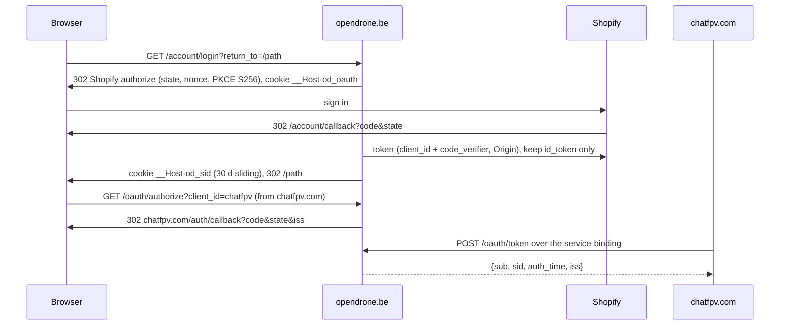

# Accounts, Early Bird and owners


## Shared accounts

opendrone.be signs customers in with Shopify Customer Accounts and is the
identity provider for chatfpv.com (`app/lib/accounts/`). ChatFPV receives a
pairwise `sub` only (`acct_` + 32 hex), never the Shopify customer id or email.
Everything is off unless `ACCOUNTS_ENABLED` is `"1"`; off, `/oauth/*` and
`/api/account/widget-assertion` answer 404 and `/account/*` keeps the legacy
redirect to `SHOPIFY_CUSTOMER_ACCOUNT_URL`.



| Route | Purpose |
|---|---|
| `GET /account/login?return_to=` | Sign-in notice (signing in creates a Shopify customer account holding the email; ChatFPV gets a separate id), then `?go=1&return_to=` starts sign-in; `return_to` must be a same-origin path |
| `GET /account/callback` | Finish sign-in, new session id |
| `POST /account/logout` | Same Origin only; revokes the session, calls ChatFPV `/v1/auth/backchannel-logout {sid}` over the binding, ends the Shopify session |
| `GET /account` | Orders link (`SHOPIFY_CUSTOMER_ACCOUNT_URL`), ChatFPV history export and delete, sign out |
| `POST /account/chatfpv-history` | Same Origin, signed in; `intent=export` downloads ChatFPV `GET /v1/account/export` as JSON, `intent=delete` + `confirm=yes` calls `POST /v1/account/erase {sub}` |
| `POST /webhooks/shopify/customers-redact` | Shopify `customers/redact`: deletes that customer's `od_accounts`, `od_sessions`, `oauth_codes` rows and erases ChatFPV; a failed ChatFPV erase becomes a pending `rights_requests` row and an ops alert |
| `POST /webhooks/shopify/customers-delete` | Shopify `customers/delete`, the fallback when the app cannot subscribe compliance topics: the same erase |
| `POST /webhooks/shopify/customers-data-request` | Shopify `customers/data_request`: recorded in `rights_requests`; the scheduled job builds the export into D1 for `scripts/accounts/rights.mjs fetch` |
| `POST /webhooks/shopify/shop-redact` | Shopify `shop/redact`: recorded, nothing else to delete |
| `GET /oauth/authorize` | Codes for client `chatfpv` (60 s, single use; a reused code revokes the session) |
| `POST /oauth/token` | Service binding only; public host 404 (staging test IdP excepted) |
| `GET /oauth/logout` | Sign-out from chatfpv.com; `post_logout_redirect_uri` from `CHATFPV_POST_LOGOUT_REDIRECTS`; Shopify's registered logout URI |
| `GET /api/account/widget-assertion` | 5-minute assertion the widget posts into the ChatFPV iframe; 204 signed out |
| `GET /account/test-idp/authorize` | Test sign-in form, only with the test IdP rule below |

The four webhooks are live whenever `SHOPIFY_WEBHOOK_SECRET` is set,
whatever `ACCOUNTS_ENABLED` says (404 without the secret, 401 on a bad
signature, 200 once recorded). They are signed with the client secret of the
custom app that holds `SHOPIFY_WEBHOOK_SECRET` (the one that sends
`orders/paid`), so the compliance topics are subscribed on that app. The
Headless channel cannot deliver them. The every-5-minute cron works the
`rights_requests` queue (`app/lib/accounts/compliance.ts`), purges accounts
1095 days after their last sign-in unless a session is live, and posts an ops
alert (`app/lib/ops-alerts.ts`: production only through `OPS_ALERTS_ENABLED`,
once per UTC day per key, to `DISCORD_STAFF_METADATA_CHANNEL_ID`) while a
request fails or an export waits.

Erase or export on an email request (one month, Art 12(3) GDPR; Shopify can
withhold `customers/redact` for up to 6 months):

```sh
node scripts/accounts/rights.mjs erase <customer id> --apply    # or export
node scripts/accounts/rights.mjs status
node scripts/accounts/rights.mjs fetch <request id> --apply     # writes the export file
```

ChatFPV calls for erase and export go by pairwise `sub` with `CHATFPV_KEY`
over the `CHATFPV` binding (`app/lib/accounts/rights.ts`). Legal text for
shared accounts is in `app/content/legal/{en,nl,fr}/` (privacy, cookies) and
the cookie list on `/cookie-settings`.

Test IdP rule: `ACCOUNTS_TEST_IDP="1"` replaces Shopify with the test form
only when the request host is not `opendrone.be` or `www.opendrone.be`. It
is never set in `wrangler.production.toml` (a unit test fails if it is).

### Create the Shopify client (Shopify admin)

The storefront is on the Hydrogen channel, whose Customer Account API client
is public: a Client ID and no secret, PKCE plus an `Origin` header that must
be listed under JavaScript origins.

1. Settings > Customer accounts: the page shows "Customer accounts" settings
   and a `https://shopify.com/<shop id>/account` URL when the new customer
   accounts are on.
2. Sales channels > Hydrogen > Opendrone Web > Customer Account API.
3. "Application setup", add to the existing lines and Submit:

| Field | Value |
|---|---|
| Callback URI(s) | `https://opendrone.be/account/callback` |
| Javascript origin(s) | `https://opendrone.be` |
| Logout URI | `https://opendrone.be/oauth/logout` |

4. "Customer Account API credentials": the Client ID is
   `SHOPIFY_CUSTOMER_ACCOUNT_CLIENT_ID`. The number in the Authorization
   endpoint `https://shopify.com/authentication/<shop id>/oauth/authorize` is
   `SHOPIFY_CUSTOMER_ACCOUNT_SHOP_ID`; otherwise set
   `SHOPIFY_CUSTOMER_ACCOUNT_ISSUER` to the endpoint without
   `/oauth/authorize`. The Worker reads the rest from
   `<issuer>/.well-known/openid-configuration`.

Shopify answers 403 to a discovery or token fetch that has no `Origin` and
`User-Agent` header, and sends the id_token `sub` as a JSON number;
`shopify-idp.ts` covers both and `accounts.test.ts` pins them.

Shopify accepts only HTTPS callbacks, so local development and version
previews use the test IdP.

### Variables and secrets

| Name | Where | Value |
|---|---|---|
| `ACCOUNTS_ENABLED` | `[vars]` in both wrangler configs | `"1"` in `wrangler.production.toml`, `"0"` in `wrangler.toml` |
| `CHATFPV_OAUTH_REDIRECTS` | `[vars]` | `https://chatfpv.com/auth/callback` (production) |
| `CHATFPV_POST_LOGOUT_REDIRECTS` | `[vars]` | `https://chatfpv.com/` (production) |
| `SHOPIFY_CUSTOMER_ACCOUNT_CLIENT_ID`, `SHOPIFY_CUSTOMER_ACCOUNT_SHOP_ID` (or `SHOPIFY_CUSTOMER_ACCOUNT_ISSUER`); `SHOPIFY_CUSTOMER_ACCOUNT_CLIENT_SECRET` only for a Headless channel confidential client (the Hydrogen channel client is public and has none) | `npx wrangler secret put <NAME> --config wrangler.production.toml` (Worker `opendrone-web`) | Step 4 above |
| `ACCOUNT_PAIRWISE_SALT` | secret, `opendrone-web` | `openssl rand -base64 32`; never rotate (every ChatFPV account id derives from it) |
| `SESSION_ENC_KEY` | secret, `opendrone-web` | `openssl rand -base64 32` |
| `CHATFPV_OAUTH_CLIENT_SECRET` | secret on `opendrone-web` AND on the ChatFPV Worker `chatfpv` (same value) | `openssl rand -base64 32` |
| `WIDGET_ASSERTION_KEY` | secret on `opendrone-web` AND on `chatfpv` (same value) | `openssl rand -base64 32` |
| `CHATFPV_KEY` | existing store key secret | unchanged; back-channel logout uses it |
| `ACCOUNTS_TEST_IDP` | never in a wrangler config; `--var ACCOUNTS_TEST_IDP:1` on staging version uploads only | `1` |

Staging (`opendrone-web-preview`) takes the same secrets with
`--config wrangler.toml` and its own random values, shared with the ChatFPV
eval or staging Worker it talks to.

### Enable order

Accounts are on in production. To enable them on a new environment, or again
after a rollback:

1. Apply `migrations/0005_accounts.sql` and `0006_rights_requests.sql`:
   `npx wrangler d1 migrations apply SUPPORT_DB --remote --config wrangler.production.toml`.
2. Put the storefront secrets above on `opendrone-web`, and the two shared
   secrets on `chatfpv`.
3. In the Shopify Dev Dashboard, open the custom app whose client secret is
   `SHOPIFY_WEBHOOK_SECRET`, Versions, and add the compliance webhooks:
   customer data request `https://opendrone.be/webhooks/shopify/customers-data-request`,
   customer erasure `.../customers-redact`, shop erasure `.../shop-redact`,
   then release. If that app offers no compliance form, subscribe
   `customers/delete` to `.../customers-delete` on the same app instead.
4. Storefront: `ACCOUNTS_ENABLED = "1"` in `wrangler.production.toml`
   (squash-merged PR). Check sign-in and sign-out on opendrone.be.
5. ChatFPV: its `ACCOUNTS_ENABLED` to `"1"`. Check "Sign in with OpenDrone"
   on chatfpv.com and silent SSO.
6. Roll back in reverse: ChatFPV first, then the storefront.

## Early Bird

A paid preorder placed before the run closes (`endsOn` in
`content/preorders.json`, end of day in Brussels) unlocks the `Early Bird`
role and the private `#early-birds` channel on the OpenDrone Discord, for one
Discord account per order. `app/lib/early-bird.ts` decides and proves;
the Discord bot Worker (OpenDrone-hw/discord, the README in its bot folder, section "Early Bird")
runs the Discord authorization, records the claim and gives the role.

| Way in | Proof | Route |
|---|---|---|
| `/account` card, or `/early-bird` signed in | the order belongs to the session's Shopify customer | `POST /early-bird` with `order=<GID>` (same Origin) |
| "Claim on Discord" in the order confirmation mail (preorder orders only) | `key` equals the `key` of the order's Shopify status page URL | `GET /early-bird?order=<id>&key=<key>` |

Qualifies: `PAID` or `PARTIALLY_REFUNDED`, not cancelled, tagged `preorder`
(or a line with the `Preorder` attribute before the tag job runs), created
before the close. A qualifying request is answered with a 303 to
`EARLY_BIRD_CLAIM_URL` (default the bot Worker's `/early-bird`) carrying a
10-minute HMAC token signed with `EARLY_BIRD_CLAIM_KEY`, a Worker secret
equal to the bot's secret of that name. Without it claims show "not open
yet". This Worker stores nothing; the bot keeps order id, order name and
Discord user id (privacy policy, section 2).

## Owners map

`/owners` shows where owners are, never how many: no per-region figure, only a milestone and a country floor. Rules live in `app/lib/owner-map.ts` (tested), the Worker side in `app/lib/owner-map-data.ts`, the page in `app/routes/owners.tsx`, the map in `app/components/OwnersMap.tsx` (geometry helpers in `app/lib/owner-map-draw.ts`), words in `content/copy/owners.json`.

The page is one full-width map under the site header with one `.visit-card` over it (a bottom sheet on phones), styled like `/visit` (shared `--map-*` colour tokens in `app/styles/app.css`). Drag pans, the wheel, pinch and the buttons zoom; the default framing is the whole world. Countries and US states with an owner are filled in gold in three shades (fewer to more, relative to the largest region, so a shade shows rank and not volume); hovering or tapping a region shows its name only. The card shows "500+" owners (the largest of 100, 250, 500, 1000, 2500, 5000 the total has reached, nothing under 100) and "30+" countries (floored to 10, nothing under 10). A screen-reader list names the countries and states, alphabetical, without figures.

| Step | What happens |
|---|---|
| Count | A distinct Shopify customer with a paid or partly refunded, not cancelled, non-test order with a physical line, counted once by the shipping country of their latest order; US customers also by state |
| Schedule | The Worker's five-minute cron reads one D1 row set and recomputes only when the snapshot is missing or 30 days old (needs `SUPPORT_DB` and the Admin token). A failed run waits 6 hours |
| Suppress | Every country and US state with an owner is published by name with a shading level (some, more, most: thirds of the largest region of its kind); US states only where the United States is published. The browser gets the milestone, the country floor and those levels, no timestamp and no other number (tested) |
| Store | Table `owner_map_snapshot` (migration 0009) keeps the level per region (0 to 2), the milestone and the country floor (column `bucket` holds the value; row `_v2` marks these rules, so rows from the earlier range rules are recomputed at the next cron run). Orders and addresses are never stored |
| Draw | d3-geo and topojson-client draw SVG from `public/geo/countries-50m.json` (world-atlas, Natural Earth, public domain) and `states-10m.json` (us-atlas, US Census). All are ISC-packaged copies from `node_modules`; no tiles, no third-party request, CSP unchanged |

Local development: `OWNER_MAP_FIXTURE=1` in `.env` shows fixture data through the same suppression and never reads orders. On the dev server the fixture is also used when the Admin token is missing. A deployed build without a snapshot shows the empty state, never invented figures; a unit test keeps `OWNER_MAP_FIXTURE` out of both wrangler files. The migration is applied like the others (`npx wrangler d1 migrations apply SUPPORT_DB --remote --config wrangler.production.toml`) before the deploy.

### Pilot map ("Find pilots near you")

Optional part of the `/owners` card and map, off unless `PILOT_MAP_ENABLED` is `"1"` (and `ACCOUNTS_ENABLED`, `SUPPORT_DB`). Off in both wrangler files. Rules in `app/lib/pilot-map.ts`, storage and Discord in `app/lib/pilot-map-data.ts`, request glue in `app/lib/pilot-map-server.ts`, UI in `app/components/OwnersPilot.tsx` (the card block) and `app/components/OwnersMap.tsx` (the dots); all tested.

| Who | Sees |
|---|---|
| Signed out | A sign-in link in the card, no dots, no figures |
| Signed in, no paid not cancelled order | A note, no figures |
| Owner (paid or partly refunded, not cancelled order, read live from Shopify, cached 1 h in a signed cookie) | Gold dots on the map for cells of about 10 km (a larger dot when more than one pilot, no number); a tap on a dot opens a popover with Discord usernames and a `discord.com/users/<id>` link. Linking, placing (tap the map, two consent boxes), moving and withdrawing are in the card |

| Route | Purpose |
|---|---|
| `GET /owners/discord` | Owner starts the Discord link: authorize URL with scope `identify`, state and PKCE S256, cookie `__Host-od_pm_oauth` (10 min) |
| `GET /owners/discord/callback` | Checks state and customer, reads Discord id and name, revokes the token, sets cookie `__Host-od_pm_link` (1 h). Nothing is written to D1 yet |
| `GET /api/pilot-map` | `{}`, or `{cells}` for a qualifying owner (decided from the session on the server); never a count |
| `POST /api/pilot-map` | Same Origin. `intent=place` needs owner, link (or an existing pin), both consent boxes and `version=PILOT_CONSENT_VERSION`; `intent=withdraw` deletes the row |

| Data | Rule |
|---|---|
| Table `pilot_map_pins` (migration 0010) | Customer GID, Discord id and name, cell id and centre, consent time and version. Never the clicked point |
| Grid | Rows of 0.09 degrees latitude; columns per row tile 360 degrees at about 10 km (`snapToCell`), deterministic, no random offset |
| Deleted by | Withdraw button, `customers/redact` and `customers/delete` (`redactCustomer`), the 3-year idle account purge, and the scheduled job 24 months after the consent |
| Consent wording | `owners.pilot_consent_box` and `owners.pilot_age_box` in `content/copy/owners.json`; change the wording and bump `PILOT_CONSENT_VERSION` in the same commit |

Environment: `DISCORD_OAUTH_CLIENT_ID` and `DISCORD_OAUTH_CLIENT_SECRET` are Worker secrets; the Discord application needs the redirect `https://opendrone.be/owners/discord/callback` (`DISCORD_OAUTH_REDIRECT` overrides). Apply migration 0010 before enabling.

Local development: with `ACCOUNTS_ENABLED=1`, `ACCOUNTS_TEST_IDP=1`, `PILOT_MAP_ENABLED=1` and `npm run db:migrate:local`, sign in through the test IdP (`/account/login`); the first test customer counts as an owner (Shopify is never asked) and "Link Discord" opens a fake Discord screen (`app/lib/pilot-map-dev.ts`, imported only behind `import.meta.env.DEV`; a test scans a build for it). The privacy policy rows are drafts, not reviewed.
