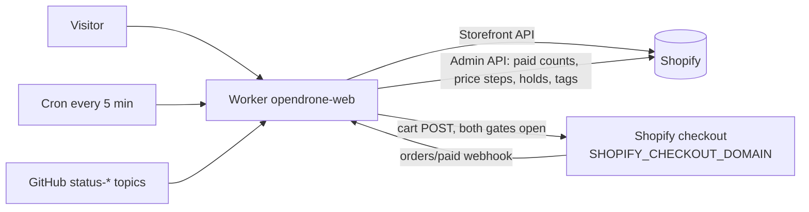
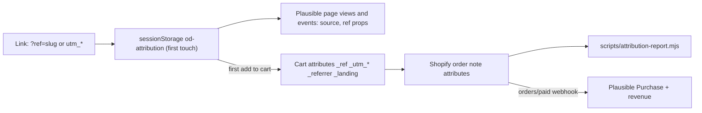

# How the site works

Catalog, checkout, preorders, pages, security and analytics.




**Catalog.** `app/lib/shopify-storefront.ts` reads the Shopify Storefront API
into the catalog shape in `app/lib/catalog.ts`. `SHOPIFY_PREVIEW_POLICY_JSON`
sets a SKU's `saleMode` (`in_stock`, `preorder` or `sold_out`, plus
`shipPromise`). A SKU it does not name sells as `preorder` when
`content/preorders.json` sells it, and is `sold_out` when only a product file
lists it (`skus` in `content/products/<handle>.json`). Any other SKU, a non-EUR
price or missing VAT confirmation fails the catalog closed. Country-context reads use
Shopify's destination prices and currency after this base check. The US keeps its USD ladder; other international destinations
copy live country prices without inferring later price steps. Missing prices
close the affected destination variants. Customer-account links stay hidden unless an
exact Shopify account URL is configured.

**Checkout.** Checkout is open only when `SHOPIFY_CHECKOUT_WRITE_ENABLED=1` and
`PUBLIC_COMING_SOON=0` (`checkoutOpen` in `app/lib/shopify-cart-action.ts`).
Open, `/cart` renders the session cart and `POST /api/shopify/cart` adds
lines after same-origin, SKU, availability and lifecycle checks; the checkout
URL Shopify returns must be on `SHOPIFY_STORE_DOMAIN` or
`SHOPIFY_CHECKOUT_DOMAIN`, otherwise the add fails. Closed, `/cart` redirects
to `/products` and cart POSTs are refused. `PUBLIC_COMING_SOON` other than `0`
also renders every product as coming soon, with a notify-me signup instead of
prices.

**Preorders.** `content/preorders.json` lists production batches per SKU: paid
stock (on hand in Belgium when `inStock`), or a funding batch. With
`confirmed: true` (terms 2.9) every funding batch is
produced whatever its count and ships by `shipsBy`; without it a funding batch
is a target whose supplier order is placed once that many units are ordered.
Only SKUs the policy sells as `preorder` are affected.

| Piece | Where | Does |
|---|---|---|
| Paid counts | `app/lib/shopify-orders.ts` | counts paid Shopify orders per SKU since `countFrom`, cached one minute per isolate; if unreadable, campaign SKUs close |
| Batch and promise | `app/lib/preorder-campaign.ts` | derives the batch, the meter and the ship promise (ship date only, never a delivery date) |
| Cart line | `app/lib/shopify-cart-action.ts` | every preorder line carries its promise as a `Preorder` attribute, so checkout and the confirmation state it |
| Price steps | `app/lib/shopify-price-tier.ts` | `priceTiers` steps the price off the compare-at (retail) price as the EU step bar fills ([selling.md](selling.md#run-a-preorder-campaign)); sale prices are owned by Shopify and the step is written there only when `SHOPIFY_PRICE_TIER_WRITE_ENABLED=1`; a SKU Shopify prices under its step closes |
| Holds and tags | `app/lib/preorder-fulfilment.ts` | holds each open fulfillment order (handle `opendrone-preorder`) and tags the order `preorder` and `batch:<SKU>:<N>`; a tagged order is never held again; a held preorder's "Fulfill by" deadline is set to the ship-by date it was sold under (`shipsBy`) instead of Shopify's next business day |
| Accessories | `shipsWith` in `content/preorders.json` | spares ride a campaign SKU at a flat price, pinned to a dated batch or following the lead's next unit; they do not count toward the lead |
| Health | `/api/status/campaign` | anonymous: `allOpen` and the status code only; with `Authorization: Bearer <CAMPAIGN_STATUS_TOKEN>` (Worker secret): per campaign SKU: open or closed, paid counts, pending price steps, hold health (unheld paid orders, overfull batches; reused for a minute per isolate), last job runs; `503` when a campaign SKU is closed or `holdsOk` is false |

Price steps and holds run from the `orders/paid` webhook
(`/api/shopify/orders-paid`, HMAC-verified with `SHOPIFY_WEBHOOK_SECRET`,
`503` without it) and from the Worker's five-minute `scheduled` reconcile.
`/preorder` explains the model and tracks every target. The model is an
ordinary Shopify order paid in full with custom batch logic, not Shopify's
selling-plan preorders.

**Cart country.** A new cart gets the visitor's country (`CF-IPCountry`) as
its Shopify buyer country. `POST /api/shopify/cart-country` (form field
`country`, same-origin, open only when checkout is) sets another country on
the session cart. EU consumer destinations retain the `saleApproved` rule in
`content/registrations.json`. The US retains its sales gate and flat USD rate.
Other valid countries outside the blocked and uninhabited sets accept
international preorders, with shipping charges confirmed at Shopify checkout.
The destination cookie, buyer country and campaign promises move together.
The final address is
restricted by Shopify's markets and shipping profiles, not by this gate.

**Product lines.** OpenESC 20x20 / 30x30 and the four OpenRX variants are one
Shopify product with a `Model` attribute; the page renders a tier ladder matched
to the catalog's variants by option name and value. Product images use Shopify
CDN URLs directly.

**Status.** The `status-*` GitHub topics describe roadmap lifecycle; they never
authorize a purchase. Topics are cached; the static fallback in
`app/lib/roadmap-data.ts` must lag the topic, never lead it. While the shop is
open, `app/lib/launched-roadmap.ts` shows a board with a paid batch as at least
beta. `/roadmap`, the product pages, the feeds and the README badge endpoint
`/api/status/<Repo>.json` use these inputs. Read [product-status.md](product-status.md)
before touching that chain.

**Product pages** are a sequence of typed chapters (teardown, schematics, open
source, specs, in the box, downloads, firmware, reviews, contributors, prose)
ordered and toggled per product in `content/products/*.json`. The teardown is a
layered SVG of the real PCB exported from KiCad; scrolling peels the copper
layers apart.

**Board art and specs come from the board repositories.** `npm run
gen:board-art` shells out to `kicad-cli` and KiCad's `pcbnew` Python to export
each PCB (`scripts/boards.config.json` maps handles to `.kicad_pcb` paths
relative to the directory holding the board checkouts, `../hardware` by default,
`OPENDRONE_HARDWARE` overrides). `npm run sync:specs` reads each mapped
README's `## Specifications` table (`scripts/repo-sync.config.json`) into the
product JSON. Rows a README does not carry go in `specsExtra` (product or
tier), accessory rows in `content/accessories.json`. Keys named in a
`placeholders` array are values awaiting the final figure, never marked on the
page; `npm run specs:placeholders` lists them.

**Homepage hero.** A three.js scene (`app/components/HeroDroneScene.tsx`) plays
the Onshape assembly, exported as one GLB and chunked by
`scripts/hero-assets/build-hero.mjs` into `public/models/<design>/`. It loads
only on desktop with `prefers-reduced-motion: no-preference`; everyone else
gets a static splash, and every beat's copy is plain DOM text. Pipeline and
tuning: [hero-studio.md](hero-studio.md).

**Timeline.** `/timeline` combines a curated list in `app/routes/timeline.tsx`
with `timeline-ledger.json` on this repository's unprotected `data` branch,
appended daily by `.github/workflows/timeline-ledger.yml` from releases, new
repos and `status-*` flips across the public OpenDrone-hw repositories.

**Support.** See [support.md](support.md).

**Trade.** `/wholesale` accepts short retailer and distributor applications
from any country (ISO 3166-1 plus Kosovo); staff decide per application. The
server mails each application (company, contact, country, business type,
estimated quantity per order for each product line, and optional VAT or tax ID,
order rhythm, website and message) through Resend from `SUPPORT_FROM_EMAIL` to the
company inbox (`PUBLIC_COMPANY_EMAIL`), with reply-to set to the applicant.
Shopify Companies is not used: B2B is not available on the store's Shopify
plan. No customer or company record is created, nothing is mailed to the
applicant, and no pricing, tax exemption, order or delivery commitment is made
by an application.

An approved retailer orders in the normal shop and pays 75% of retail (for a
reverse-charge customer 75% of net retail, see `docs/wholesale.md`; 25%
off, `WHOLESALE_PERCENT` in `scripts/wholesale_lib.py`) whatever preorder price
step a product is on. Retail is the Shopify compare-at price. The retailer
types one personal code, `WS<rate>-<NAME>` (for example `WS25-FPV24`), in the
cart's "Wholesale code" field (`intent=discount` in
`app/lib/shopify-cart-action.ts`). With `BATCH_CHOICE` on, that field shows
only to a retailer: after a visit to `/wholesale` or through any link with the
`wholesale` parameter (`/cart?wholesale=1`, the link the approval mail gives),
remembered for the session, or when the cart already carries a code
(`wholesaleFieldShown` in `app/lib/wholesale-codes.ts`). The cart sends that code with its price-group
companions `-G2` to `-G4` (`app/lib/wholesale-codes.ts`) through
`cartDiscountCodesUpdate`. Each is a customer-limited Shopify percentage code
scoped to the variants of one price group, because Shopify takes a percentage
off the live price, not off compare-at. `scripts/wholesale-onboard.py` (VIES
check, customer, tag `wholesale`, EU reverse charge exemption only for a valid
VIES number outside BE, the codes) and `scripts/wholesale-sync.py` (re-points
the groups after a price step; daily job `wholesale-sync` in the workspace) are
dry run by default; `--apply` writes and reads back. The storefront passes no
buyer identity to checkout (the sign-in drops Shopify's access token on
purpose), so the retailer signs in at Shopify checkout with the approved email
for the exemption and the customer-limited codes to apply. Procedure, VAT per
country, batch caps, refunds and the test order: `docs/wholesale.md`. Public
consumer checkout retains its existing behavior.

The switch is `TRADE_MAIL_ENABLED=1` with `RESEND_API_KEY` set; without both
the page shows the contact address instead of the form. A repeat application
within 24 hours reuses its Resend idempotency key and is not mailed twice. A
Resend error or timeout reports failure to the applicant. Same-origin checks,
Turnstile and rate limits protect submissions. Local development never sends.
The page is in `app/routes/wholesale.tsx`; validation and the mail are in
`app/lib/trade.ts`.

**Reviews.** The PDP's rating line and reviews chapter read Shopify's standard
`reviews.rating` and `reviews.rating_count` product metafields, maintained by
the installed review app (Judge.me). No third-party script runs on the page. A
product without those metafields renders no trace of the feature.

**Newsletter.** Posts are written in Shopify admin (Content, Blog posts, blog
`News`). A visible post shows at `/newsletter/<handle>`, in `/newsletter.rss`
and in the sitemap; a hidden one does not exist on the site; the tag
`no-archive` keeps a visible post off the list, feed and sitemap. The site reads
the blog through the Storefront API (`app/lib/posts.ts`), so a change shows
without a deploy. The footer signup records single-opt-in consent in Shopify
and adds the `newsletter` tag plus `notify-<handle>` for product interest, and
`country-<CODE>` for a visitor from a country sold only through shops.
`/newsletter/unsubscribe` sets Shopify consent to `UNSUBSCRIBED`.
`SHOPIFY_NEWSLETTER_WRITE_ENABLED` gates consent writes independently of
checkout.

**Send a post to the subscribers.** Shopify admin, Messaging (Shopify Email),
Create campaign: the post image, two or three lines, and a button to
`https://opendrone.be/newsletter/<handle>`; audience "Email subscribers".
Shopify owns the list, the unsubscribe link and the sending; sending is a
human action. Resend sends only the site's own mail (welcome, preorder
notices, support).

**Legal.** The legal documents in `app/content/legal/{en,nl,fr}/` serve at
`/{en,nl,fr}/<slug>`; the bare `/<slug>` redirects to the visitor's cached
locale, and `LangToggle` appears only on legal paths. They are drafted and
reviewed in the private `operations` repository; this repository receives only
the approved text, in one publish PR. The site UI is English-only. `/recycling` adds the
producer (EPR) registration numbers per EU country from
`content/registrations.json`; a number still `null` is not shown.

**Other routes.**

| Route | Behaviour |
|---|---|
| `/products` | the one browse page; `/collections/*`, `/search`, `/cart/*` and `/discount/*` redirect to it |
| `/preorder`, `/wholesale`, `/shipping`, `/roadmap`, `/timeline` | content pages driven by the sources above |
| `/open-source`, `/production`, `/firmware-partners` | content pages |
| `/doc/<sku>` | per-SKU EU Declaration of Conformity page |
| `/learn` | draft-gated, noindex knowledge pages |
| `/contact` | redirects to `/support`; `/account/support` goes to `/support/find`, other `/account/*` to the Shopify account |
| `robots.txt`, `sitemap.xml`, `security.txt`, `healthz`, `llms.txt`, `products.json` | generated live from the catalog |
| `/blog*`, `/releases*`, `/contribute`, `/incutec` | 301 stubs |

## Editorial manifest

Read-only evidence of what is live, for the company app's storefront console. Off unless `EDITORIAL_API` is `"1"` (`"0"` in `wrangler.production.toml`); off answers 404. Same credential as the staff API (`SUPPORT_STAFF_API_TOKEN` bearer, plus the Access JWT when configured); never public. Nothing here publishes: a merge to `main` or the Worker deploy stays a person's click.

- `GET /api/editorial/manifest`: the contract's page (`editorial.manifest` v1, `items` as `{ref, revision, audience}`) plus `manifest`: every file under `content/**/*.json` and `app/content/**/*.md` with path, kind, locale, title, `sha256` of the source, last commit and date (null when the build had a shallow checkout), `editable` or `generated`, the build commit and time, `manifest_hash` and declared `gaps`. Generated at build by `app/lib/editorial/manifest.ts` (Vite virtual module), not at runtime.
- `GET /api/editorial/receipt`: `publication.receipt` evidence of the running deployment: `deployed_revision` (build sha), `manifest_hash` (also `verification_ref`), `build_time`, `deployed_at` and `worker_version_id` (from the `CF_VERSION_METADATA` binding).

## Analytics and attribution

Plausible (cookieless, loaded only on opendrone.be) counts page views and
funnel events; the order itself carries its source. Every page view and
event carries the session's `source` and `ref` props, so any report can be
filtered by creator. Outbound link, file download and form submission
tracking are switched in the Plausible site settings, not in code. Details:
[growth-architecture.md](growth-architecture.md).



| Link | Use |
| --- | --- |
| `https://opendrone.be/?ref=<slug>` | Creator link. Slug: lowercase letters, digits, `-`, `_`, at most 32 characters, one per creator (`alice-fpv`). Any page works: `/products/openfc?ref=alice-fpv` |
| `?utm_source=&utm_medium=&utm_campaign=` | Channel links, canonical values in the growth doc |
| `?utm_source=youtube&utm_content=<video id>` | Video description links: the order carries the video id (`_utm_content`, case kept) |

The slug reaches the order only when the visitor adds to cart with
JavaScript in the same browser session (tab) as the link visit; the
cookie policy keeps it session-only. Plausible shows the slug as a source
for visits whatever happens next.

Sales per creator and channel, read only:

```bash
node --experimental-strip-types scripts/attribution-report.mjs --since 2026-09-25 [--until YYYY-MM-DD] [--orders | --json]
```

It reads `SHOPIFY_STORE_DOMAIN`, `SHOPIFY_ADMIN_API_TOKEN` (read_orders) and
`SHOPIFY_ADMIN_API_VERSION`, and prints paid orders, units per SKU and
revenue by `_ref` and by `_utm_source`. `--json` adds the shipping
country groups and the counted orders without names. The Plausible `Purchase` event is
sent only while the Worker variable `PLAUSIBLE_PURCHASE_EVENTS_ENABLED` is
`1`; it forwards the buyer's browser IP and User-Agent from the order,
without which Plausible drops server events.

## Security

- Headers (`app/entry.server.tsx`): nonce-based CSP, HSTS with preload,
  `X-Frame-Options: DENY`, nosniff, strict referrer policy, restrictive
  Permissions-Policy, COOP and CORP.
- Rate limits: a per-isolate sliding window on every public POST; support
  also caps new tickets per email per day in D1.
- Support: Turnstile and a same-origin check on every ticket POST, HMAC-signed
  resume links and cookie, attachments checked by type, extension and size,
  both relay directions scrubbed, no message content or email in logs.
- Commerce credentials are server-only Worker secrets. `.env` is gitignored;
  never expose tokens or the SKU policy in client data. Rotate the session
  secret, the Resend key and the Turnstile secret annually or on suspicion.
- Disclosure: GitHub private vulnerability reporting,
  `/.well-known/security.txt`, policy at `/security`, default embargo 90 days.
