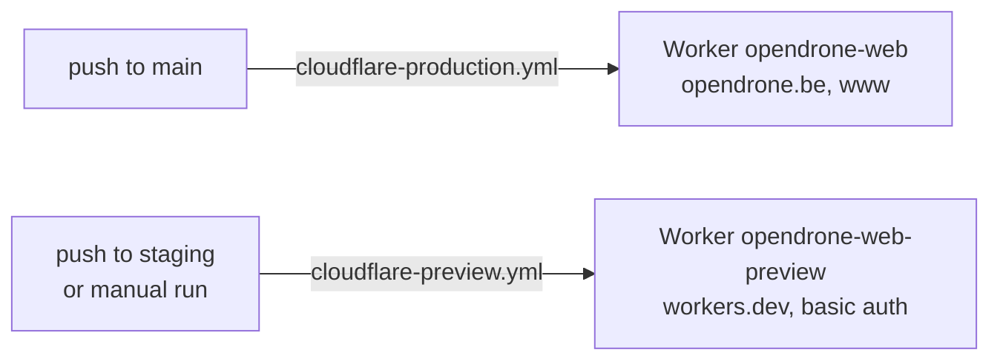

# Deploy and configuration

## Hosting and deploy

| | Production | Staging |
|---|---|---|
| Config | `wrangler.production.toml` | `wrangler.toml` |
| Trigger | every push to `main`: a merge is a production deploy | every push to `staging`, or a manual run of the workflow |
| Hostnames | `opendrone.be`, `www.opendrone.be` (Custom Domains; `server.ts` redirects `www` to the apex) | a workers.dev URL, HTTP basic auth (user `opendrone`, `STAGING_PASSWORD`), `X-Robots-Tag: noindex, nofollow` |
| Shop | the gates in its `[vars]` | always open, against the same Shopify store; pay with Shopify's test gateway |
| Price steps and cron | yes | never writes prices |

To preview any branch on staging, push it to `staging`:
`git push --force origin HEAD:staging`. Static files from `dist/client` are
served by Cloudflare before the Worker runs, so they bypass basic auth and the
noindex header. Both workflows use the repository secrets
`CLOUDFLARE_API_TOKEN` and `CLOUDFLARE_ACCOUNT_ID` and pin wrangler 4.
`community-sync.yml` refreshes the contributor roster; `timeline-ledger.yml`
updates the public repository timeline.

**D1 migrations.** `cloudflare-production.yml` runs `scripts/d1-migrations.sh
apply` before `wrangler deploy`, so a deploy never runs code whose tables are
missing. With the account permission
**D1: Edit** on the repository secret `CLOUDFLARE_API_TOKEN` it applies the pending
migrations of `SUPPORT_DB`. Without the permission the script
compares `migrations/` with the live Worker's `GET /api/support/schema` (applied
migration names, no ticket data) and **fails the run before the deploy** when one
is pending; apply it by hand
(`npx wrangler d1 migrations apply SUPPORT_DB --remote --config wrangler.production.toml`)
and re-run.
`d1-migrations.yml` probes the same on a pull request that touches `migrations/`
and only warns.

## Environment variables

The annotated list is [`.env.example`](.env.example). `PUBLIC_*` values reach
the client bundle; tokens and the SKU policy never do.

| Group | Variables | Set as |
|---|---|---|
| Session | `SESSION_SECRET` | Worker secret |
| Shop gates | `PUBLIC_COMING_SOON`, `SHOPIFY_CHECKOUT_WRITE_ENABLED`, `PUBLIC_US_SALES` | `[vars]` in the wrangler config |
| Storefront | `SHOPIFY_STORE_DOMAIN`, `SHOPIFY_STOREFRONT_TOKEN`, `SHOPIFY_STOREFRONT_API_VERSION`, `SHOPIFY_CHECKOUT_DOMAIN`, `SHOPIFY_PRICES_INCLUDE_VAT`, `SHOPIFY_PREVIEW_POLICY_JSON`, `SHOPIFY_CUSTOMER_ACCOUNT_URL` | Worker secrets |
| Admin | `SHOPIFY_ADMIN_API_TOKEN`, `SHOPIFY_ADMIN_API_VERSION`, `SHOPIFY_PRICE_TIER_WRITE_ENABLED`, `SHOPIFY_WEBHOOK_SECRET` | Worker secrets |
| Mail | `SHOPIFY_NEWSLETTER_WRITE_ENABLED`, `RESEND_API_KEY`, `SUPPORT_FROM_EMAIL`, `TURNSTILE_*`, `DISCORD_SUPPORT_INVITE`, `PUBLIC_DISCORD_INVITE`, `PUBLIC_COMPANY_*` | Worker secrets or vars |
| Support tickets | `SUPPORT_DB` (D1 binding), `DISCORD_BOT_TOKEN`, `DISCORD_GUILD_ID`, `DISCORD_SUPPORT_CHANNEL_ID`, `DISCORD_STAFF_METADATA_CHANNEL_ID`, `SUPPORT_MOD_ROLE_ID`, `SUPPORT_MODERATION_MODE`, `SUPPORT_SESSION_SECRET`, `SUPPORT_CLEANUP_SECRET` | binding in the wrangler config, the rest Worker secrets |
| Support switches | `SUPPORT_SHOPIFY_WRITE_ENABLED`, `SUPPORT_EMAIL_NOTIFY_ENABLED`, `SUPPORT_MAIL_INTAKE_ENABLED` | `[vars]` in `wrangler.production.toml` |
| Support mail drafts | `SUPPORT_MAIL_SA_JSON`, `SUPPORT_MAIL_MAILBOX`, `SUPPORT_MAIL_ADDRESSES`, `SUPPORT_MAIL_OWN_DOMAINS`, `SUPPORT_MAIL_ALLOW`, `SUPPORT_MAIL_DENY`, `SUPPORT_MAIL_WINDOW_DAYS` | Worker secrets ([support.md](support.md#mail)) |
| Shared accounts | `ACCOUNTS_ENABLED`, `CHATFPV_OAUTH_REDIRECTS`, `CHATFPV_POST_LOGOUT_REDIRECTS` (vars); `SHOPIFY_CUSTOMER_ACCOUNT_*`, `ACCOUNT_PAIRWISE_SALT`, `SESSION_ENC_KEY`, `CHATFPV_OAUTH_CLIENT_SECRET`, `WIDGET_ASSERTION_KEY` (secrets); `ACCOUNTS_TEST_IDP` never in production | see [accounts.md](accounts.md#shared-accounts) |
| Roadmap | `GITHUB_STATUS_TOKEN` | Worker secret |
| Analytics | `PLAUSIBLE_PURCHASE_EVENTS_ENABLED` (off unless `1`) | `[vars]` in `wrangler.production.toml` |
| Staging only | `STAGING_PASSWORD` | Worker secret |
