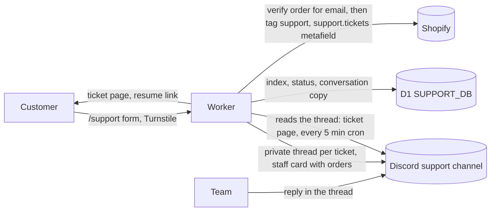
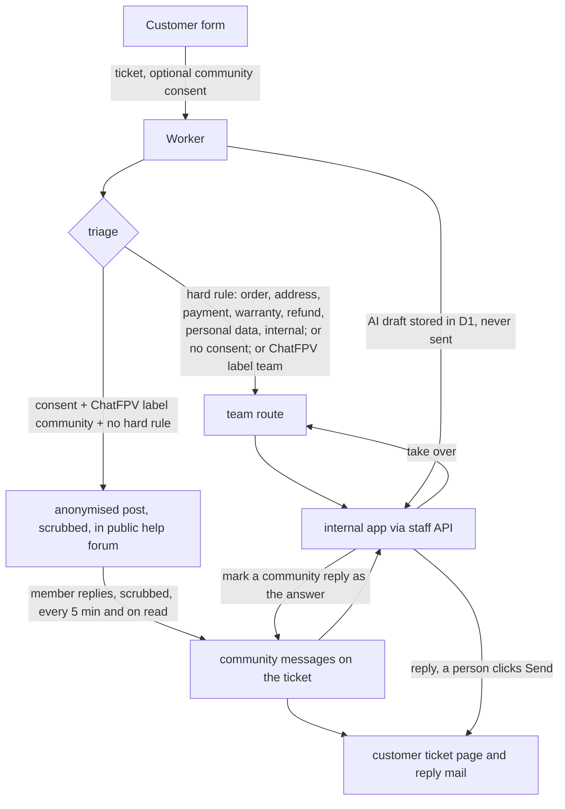
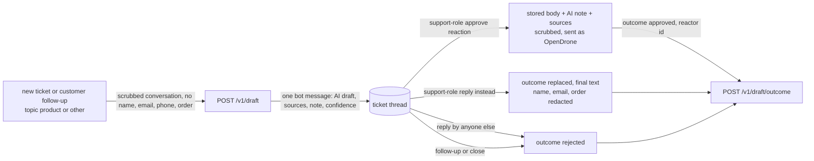

# Support


## Support tickets

Orders, payment, shipping, warranty and any private question go through a
ticket. The customer opens and follows it on the site; the team answers in
Discord (or, with `SUPPORT_CRM_API` on, in the internal app: "Support CRM");
Shopify's customer record is the CRM view. No Discord account is
needed to open a ticket. Public board questions go to `#help` on the
OpenDrone Discord, which the `/support` Community card links; the
OpenDrone-hw/discord README, "Support", has the routing for all three
systems.



| Piece | Where | Does |
|---|---|---|
| Front door | `/support` (`app/routes/support.tsx`) | topic (order, product, warranty, other), the fields that topic needs, attachments, Turnstile; tickets this browser opened; find, community and sales links |
| Ticket page | `/support/t/<ref>` | status, conversation, reply with attachments, mark solved, the private link (copy, replace); refreshes every 8 s while visible |
| Way back | `/support/resume?t=<token>`, `/support/find` | an HMAC-signed link (90 days, per ticket link version); or the email plus the ticket number (that ticket), or plus an order number Shopify confirms for that email (the tickets about that order; 8 wrong order numbers per email, from any IP, stop that route until one drains every 6 hours) |
| Rules | `app/lib/support/tickets.ts` | create, relay both ways, status, find, scheduled jobs |
| Discord | `app/lib/support/discord.ts` | REST only; private thread (text channel) or post (forum channel) per ticket |
| Shopify | `app/lib/support/shopify.ts` | order ownership check, exact-email customer match, `support` tag and `support.tickets` metafield |
| Safety | `scrubber.ts`, `moderation.ts`, `uploads.ts`, `tokens.ts`, `limits.ts` | scrub both directions, customer text escaped in Discord, optional approval gate, 5 files of 8 MB (24 MB total; images, video and PDFs checked by content in the browser and the Worker, programs refused under any name), signed cookie and links, rate limits (creating and finding counted in D1 per IP, an IPv6 client by its /64, then per IP plus email) |
| Jobs | `server.ts` `scheduled`, `POST /api/support/cleanup` | sync open tickets, reply notices when enabled, close answered tickets after 30 silent days and any other after 90 idle days, delete tickets 24 months after closing |

**Identity.** The email on a ticket is a claim. An order number that
Shopify confirms for that email makes it a match, not proof: order numbers
are sequential and printed on shipping labels. On a match the ticket is
linked to the Shopify customer, the staff card says **email and order
number match (not proof of identity)**, shows the order history and earlier
tickets (those opened without a matching order marked **email not
verified**), and the customer record gets the `support` tag and the ticket
in `support.tickets`. Change an address or refund only after a reply from
the email on the Shopify order. Without a match the card says **email not
verified** and shows none of that; ask for the order number before sharing
order details.

**For the team, in the ticket thread.** The first message is the staff card:
reference, topic, first name, whether the email and order number match,
and on a match the order with its preorder batch and recent orders. Customer
messages arrive as a quote under "Name · customer", with markdown escaped
and masked links shown as their real address. The email and the Shopify
admin link go to `DISCORD_STAFF_METADATA_CHANNEL_ID` when set.

| In the thread | Effect |
|---|---|
| a message | relayed to the customer (first name only, emails, phone numbers, IBANs, cards, tokens and Discord mentions redacted); status Answered |
| `// ...` | internal note, never relayed |
| `!waiting` | status Waiting on you |
| `!answered` | status Answered |
| `!close` | Closed; a customer reply reopens it |
| `!open` | Open again |
| locking or deleting the thread | Closed and locked: the customer is told to open a new ticket |
| editing or deleting a relayed reply | the customer's page follows (in enforce mode an edited reply is withdrawn; post it again). Only the newest 100 messages of a thread are re-checked; for an older reply, post a correction |

Messages are handled in thread order, once each. With
`SUPPORT_MODERATION_MODE=enforce` a reply reaches the customer only after a
holder of `SUPPORT_MOD_ROLE_ID` reacts ✅; the bot marks a held reply ⏳,
and later messages and commands wait behind it until it is approved.
Removing the ✅ after a reply was relayed does not withdraw it: delete the
message instead. The Worker reads reactors only when a reply's ✅ count
changes, and follows Discord's rate-limit headers: a wait up to 3 s is
waited out once, a longer one ends that sync until the next pass.

**Status.** Open (the team is up), Answered, Waiting on you, Closed.

**Email.** A new ticket sends one "we received your ticket" mail (reference and a
fresh link, no message content) from `SUPPORT_FROM_EMAIL` through Resend, under the same
switch as the reply notice. The outcome is a `support_audit` row (`confirmation_sent` or
`confirmation_failed`, actor `system`), visible in the CRM audit trail. Replies are not emailed while `SUPPORT_EMAIL_NOTIFY_ENABLED` is
not `1`; the ticket page and the private link carry the conversation. It is
`1` in `wrangler.production.toml`: the cron sends one "new reply" mail per unseen reply, with a
fresh link and no message content.

**Retention.** Tickets are deleted 24 months after closing: the entry in the
customer's `support.tickets` metafield (a ticket waits while that fails),
the Discord thread, the staff-metadata post and the D1 rows. Rate counters
hold keyed hashes, never an IP or email, and go after a day (the per-email
order-number misses once drained, at most two days). `POST /api/support/cleanup` with `Authorization: Bearer
$SUPPORT_CLEANUP_SECRET` runs it by hand (`?dry=1` lists, `?jobs=1` runs
the whole cron pass).

**Retired.** `/api/support/{start,send,poll,list,lookup,status,thread,close,notify,feedback}`
answer `410`.

### Support CRM (staff API and community route)

Two switches. `SUPPORT_CRM_API` is `"1"` in `wrangler.production.toml` and `"0"`
in `wrangler.toml`; `SUPPORT_COMMUNITY_ROUTE` is `"0"` in both.

| Flag | On | Needs |
|---|---|---|
| `SUPPORT_CRM_API` | the staff API answers; a new ticket opens **no Discord staff thread and no staff-metadata post**; customer and staff attachments go to R2, Discord never gets a file | secret `SUPPORT_STAFF_API_TOKEN`; R2 bucket `SUPPORT_FILES` when attachments are used |
| `SUPPORT_COMMUNITY_ROUTE` | a consenting customer's community-labelled question is posted, anonymised, to the public help forum | `SUPPORT_CRM_API`, `CHATFPV_DRAFTS_ENABLED`, `DISCORD_HELP_CHANNEL_ID` (forum channel, the bot can read and post), final consent wording |

Tickets opened before the flag keep their Discord thread: the thread is still read
(customer and staff messages), a CRM reply is mirrored into it as text, files are not.



The hard rules (`app/lib/support/community.ts`) run before and beat the AI label.
They are keyword and scrubber checks, deliberately broad: a false positive costs a
team reply, a false negative publishes a customer's matter. ChatFPV's draft response
may carry `route: "community" | "team"` (`chatfpv-contract.ts`); absent means team.

The consent checkbox and the post footer are placeholders marked `TODO-LEGAL` in
`app/lib/support/community.ts` (not final text); the privacy notice must name the
public post before the flag is turned on. The consent is stored per ticket
(`community_consent`); the forum post is deleted with the ticket after 24 months.

**Staff API.** Base `/api/staff/support`, JSON, `Cache-Control: no-store`. Every
request: `Authorization: Bearer $SUPPORT_STAFF_API_TOKEN`. Writes also need
`X-Staff-Login: <login>` (`[A-Za-z0-9._@+-]{1,64}`, the person in the app); it is
the audit label (`support_audit`: login, action, ticket, ids; never message text),
not a credential. When `SUPPORT_STAFF_ACCESS_TEAM_DOMAIN` and
`SUPPORT_STAFF_ACCESS_AUD` are set, the request must also carry a valid Cloudflare
Access JWT (`Cf-Access-Jwt-Assertion`, RS256 against the team certs, audience, issuer,
expiry, and the service token when `SUPPORT_STAFF_ACCESS_CLIENT_ID` is set). Status:
404 flag off, 401 bad token, 403 Access refused, 400 `staff_login_required`, 503 not configured.
Errors are `{"ok":false,"error":"<code>"}`; success is `{"ok":true,...}`.

`POST /tickets/:ref/reply` accepts `Idempotency-Key` (1-255 visible ASCII
characters, no spaces). Reuse the key after an unknown outcome: the same
ticket, staff login, body, draft, status, author and attachments return the
original 201 result, even if the ticket has since changed. JSON property order
and multipart boundaries do not matter; attachment names, types, order and
bytes do. Changed content with the same key returns 409 `idempotency_conflict`.
Successful results and hashed keys are stored in D1 with the ticket's retention
(at least 24 hours), and removed with the ticket. Validation failures do not
reserve a key. Calls without the header retain the existing behavior.
Migration `0012_support_reply_idempotency.sql` is applied by the production
deploy's migration step before the Worker is deployed. An unverifiable schema
blocks production deployment.

| Method and path | Body or query | Returns |
|---|---|---|
| `GET /status` | | `crm`, `communityRoute`, `files`, `drafts` booleans |
| `GET /tickets` | `status` (comma list of open,waiting,answered,closed), `route` (team,community), `assignee` (login or `none`), `priority`, `topic`, `tag`, `q` (ref, subject, email, order, preview), `limit` (1-100, default 50), `before` (an `updatedAt`) | `tickets[]` (ticket object), `next` (cursor or null) |
| `GET /tickets/:ref` | | `ticket`, `messages[]`, `notes[]`, `drafts[]` (pending AI drafts), `audit[]` (last 50). Reads the community post first |
| `GET /tickets/:ref/customer` | | `customer`: `match`, `orderMatched` (the ticket's order number matched this email; false means flag the email as not verified), `shopifyUrl`, `contact` (Shopify name, email, phone, default address), `orders[]` (name, createdAt, financial, fulfillment, `preorderBatches`, items, `total`, `shippingAddress`, `shippingPhone`, `trackingNumbers`; for a Shopify customer whose email equals the ticket's), `earlierTickets[]`. Unmasked: the app is behind Cloudflare Access and staff need it to fulfil. No card or bank data exists in it |
| `POST /tickets/:ref/resend-confirmation` | | sends the "we received your ticket" mail again to the ticket's address (a person's click; audited); 502 `mail_not_sent` |
| `GET /tickets/:ref/draft` | | `draft` (`draftId`, `body`, `text` = body plus the AI disclosure line, `citations`) or null |
| `PATCH /tickets/:ref` | any of `status`, `assignee` (login or null), `priority` (low,normal,high,urgent), `tags` (at most 10, `[a-z0-9 ._:-]` up to 30) | `ticket`; `status: closed` closes like `!close`; leaving closed reopens |
| `POST /tickets/:ref/notes` | `{body}` (internal, never shown to the customer) | `note` (201) |
| `POST /tickets/:ref/reply` | JSON `{body, draftId?, status?: "answered"\|"waiting", authorName?}` or multipart with the same fields plus `files` (the form's limits) | `ticket`, `message` (201). 409 `locked`, 422 `empty`, `too_long`, `filtered`, 503 `files_unavailable` |
| `POST /tickets/:ref/takeover` | | community ticket to the team route, assigned to the caller, forum post told; 409 `not_a_community_ticket` |
| `POST` or `DELETE /tickets/:ref/messages/:seq/answer` | | mark or unmark a community reply as the answer (a mark also sets Open to Answered); 409 `not_a_community_reply` |
| `GET /tickets/:ref/files/:id` | | the R2 attachment, always a download |
| `GET /saved-replies` | | `replies[]` (`id`, `title`, `body`, `updatedBy`, `createdAt`, `updatedAt`) |
| `POST /saved-replies`, `PUT /saved-replies/:id`, `DELETE /saved-replies/:id` | `{title (80), body (8000)}` | `reply` (201 on create); 404 unknown id |

Ticket object: `ref, subject, preview, topic, status, route, assignee, priority, tags,
name, email, orderNumber, orderVerified, product, customerMatch, locked,
communityConsent, inCommunity, hasDiscordThread, createdAt, updatedAt, lastCustomerAt,
lastStaffAt, lastCommunityAt, closedAt` (times in ms). Message object: `seq, role
(customer|staff|community|system), author, body, at, answer, attachments[{id, filename,
size, href}]`; a `system` body is an event code (`closed_by_team`, `reopened_by_team`,
`sent_to_community`, `taken_over_by_team`, ...).

A staff reply keeps what staff write (emails, phone numbers, addresses); only card
numbers and tokens are refused (`filtered`). It is stored for the ticket page, and mailed as the usual content-free "new reply"
notice by the cron once `SUPPORT_EMAIL_NOTIFY_ENABLED` is `1`. The moderation gate is not
applied: Send is the person's approval. An AI draft is only ever a draft: the reply that
carries its `draftId` is reported to ChatFPV as approved (text unchanged) or replaced.

**Attachments.** R2 bucket `SUPPORT_FILES`, key `<ref>/<id>`, deleted with the ticket's
24-month retention. `wrangler.production.toml` binds the bucket; `wrangler.toml` keeps the
`[[r2_buckets]]` block commented out, so there a ticket or reply with files keeps the
Discord thread path (files in the thread, `href: null` in the staff API).

### Mail

Customer email is answered by email. Every five minutes the cron reads the
last two days of mail sent to the customer addresses in one shared Gmail
mailbox, drops everything that is not a customer, asks ChatFPV for a reply
and saves it as a **Gmail draft** in the customer's thread. A person opens
Gmail, edits and sends it. Mail creates no ticket and no Discord thread, and
the Worker never sends mail: the Gmail client has `list`, `get` and
`createDraft` and no send function (a test asserts the only write is
`POST .../drafts`).

```mermaid
flowchart LR
  C[Customer mail] -->|contact@ hello@ aliases| G[(one Gmail mailbox)]
  W[Worker cron, every 5 min] -->|read, service account with delegation| G
  W -->|drop: own domain, no-reply, auto-reply, bounce, newsletter, deny list, spoofed| X[ignored, counted]
  W -->|new text, no name, email or order reference| F[ChatFPV draft]
  F -->|POST drafts, same thread| G
  W -->|counts only| D[#web-support-admin]
  H[Person] -->|edits and sends from Gmail| G
```

| Piece | Where | Does |
|---|---|---|
| Gate | `SUPPORT_MAIL_INTAKE_ENABLED` in `[vars]`, `"0"` off, `"dry"` reports counts and writes nothing, `"1"` on | `"dry"` in `wrangler.production.toml`, `"0"` in `wrangler.toml` |
| ChatFPV | `CHATFPV_DRAFTS_ENABLED` `"1"` with `CHATFPV_URL` and `CHATFPV_KEY` (the ticket draft client) | mode `"1"` reads no mail while it is off |
| Gmail client | `app/lib/support/mail-gmail.ts` | service account JWT signed with WebCrypto, scopes `gmail.readonly` (dry) or `gmail.readonly` plus `gmail.compose` (`"1"`), `messages.list`, `messages.get`, `drafts.create`, no dependency |
| Draft | `app/lib/support/mail-draft.ts` | RFC 2822 plain text UTF-8 reply: `To` the sender, `Re:` subject, `In-Reply-To`, `References`, thread id, quoted original (4000 characters at most) |
| Rules | `app/lib/support/mail-parse.ts` | sender, drop reasons, authentication, quote and signature removal, topic guess |
| Pass | `app/lib/support/mail.ts` `runMailIntake` | called from `server.ts` `scheduled` before the ticket jobs, and by `POST /api/support/cleanup?jobs=1` |
| State | D1 `support_mail_messages` (migrations 0007, 0008) | per message: SHA-256 of the Message-ID, Gmail ids, outcome (`drafted` with the Gmail draft id, `ignored`, `retry`, `failed`); no address, subject or text |

**What gets a draft.** A message addressed to one of
`SUPPORT_MAIL_ADDRESSES` (default `contact@opendrone.be`,
`hello@opendrone.be`) that no filter drops. The sender is the From header;
a Google group here does not rewrite From, so there is no other source.
Dropped, with the reason counted in the job log:

- labels spam, trash, draft, sent;
- own domains (`opendrone.be`, `incutec.eu`, plus `SUPPORT_MAIL_OWN_DOMAINS`) and `SUPPORT_MAIL_DENY`;
- `noreply`, `mailer-daemon` and similar local parts, `Auto-Submitted`, auto-reply headers and subjects, bounces;
- `Precedence: bulk` or `list`, `List-Id`, `List-Unsubscribe`, except on mail our own group relayed (it carries the group's `X-Google-Group-Id`, or a `Mailing-list` or `List-Id` naming an own domain);
- Gmail's promotions, social and forums categories;
- a spoof: DMARC failed and the sender's domain publishes `p=reject` or `p=quarantine`, unless our own group relayed it (a relayed external mail is expected to fail DMARC).

`SUPPORT_MAIL_ALLOW` lifts the automation checks for a sender, never the deny
list, own domains or the spoof check. Allow and deny lists name outside senders,
so they are Worker secrets, not repository values.

**Authentication.** Gmail's verdict on the From domain, read like this:

1. Only the topmost `Authentication-Results` header counts, and only with the authserv-id `mx.google.com` (Gmail prepends its own on receipt, so a header the sender planted sits below it). No such header means not authenticated. The `ARC-Authentication-Results` header is never read.
2. Inside it, every parenthesised comment is removed and every `arc=` entry dropped before anything is matched, because an ARC chain the sender sealed can carry `dmarc=pass` text.
3. A DMARC fail wins. A DMARC pass counts only with `header.from` aligned with the From domain. When there is no DMARC entry (Gmail omits it for a domain without DMARC), a DKIM pass whose `header.d` or `header.i` is aligned with the From domain, or an SPF pass whose `smtp.mailfrom` is aligned, counts. Alignment is equal domains or one a subdomain of the other.

**Sender not authenticated.** A mail that passes every other filter but not
authentication (a DKIM-delegated `gappssmtp.com` sender without DMARC, an
external mail relayed through support@) is still a customer and still gets a
draft. Its first line is `[CHECK BEFORE SENDING: sender not authenticated by
the mail system. Delete this line.]`, so a person has to touch the draft
before it can go out, and the heads-up counts it.

**The draft.** ChatFPV sees the subject and the new text of the mail (quotes
and signature removed): the sender's name, address and any order reference
are replaced first, the scrubber runs as for every ChatFPV call, and no order
data is passed. ChatFPV `/v1/draft` grounds its answer on public and internal
knowledge and removes citations to internal sources; a human reviews every
draft before sending. Shopify is not called on this path. When ChatFPV
returns a note for staff (for example "verify every value", "partial draft"),
it becomes a first line `[CHECK BEFORE SENDING: <note, one line, at most 300
characters>. Delete this line.]`, after the unauthenticated-sender line when
both apply. The body is ChatFPV's text, a blank line, then `On <date>, <from>
wrote:` and the new text quoted with `> `. Attachments are not imported (open
the original in the mailbox). A text part is read up to 200 KB (the rest is
cut before decoding), a part over 2 MB is skipped, HTML up to 50,000
characters. A follow-up in the same Gmail thread gets a fresh draft for the
newest message; nothing joins mails to each other. When ChatFPV is
unavailable or gives no draft (it gives none for orders, refunds or when
nothing grounds an answer), no draft is created and the mail retries. At most
5 drafts per pass, 8 mails per sender per day.

**Heads-up.** After a pass that left drafts, or used a mail's last attempt
without a draft, one message goes to `DISCORD_STAFF_METADATA_CHANNEL_ID`
(`#web-support-admin`): `Mail: 2 draft replies waiting in Gmail (1 sender not
authenticated), 1 mail without a draft.` Counts only, no names, addresses,
subjects or text, and no mentions. Without that variable nothing is posted.

**Idempotency.** A message is claimed in D1 by the hash of its Message-ID
before any work, decided messages are not fetched again, a failure retries up
to 3 passes and then stays `failed`. Nothing in the mailbox is modified except
the new drafts, so there is no label to lose. Other Gmail copies of a decided
message are remembered and not fetched again. A sender's count (8 a day) is
charged only for a mail that got a draft. A Worker killed between creating a
draft and recording it leaves two drafts of that mail after the retry; delete
one. Rows are pruned after 30 days.

**Set up.** The key is a separate service account with only the
Gmail scopes, not the workspace-admin one with Directory scopes.

1. Google Cloud console, project `incutec-admin`: create the service account
   `support-mail-intake`, create a JSON key, enable the Gmail API for the project.
2. Admin console, Security, Access and data control, API controls, Manage
   Domain Wide Delegation: for client ID `108323432558766010768`, set the OAuth
   scopes to `https://www.googleapis.com/auth/gmail.readonly,https://www.googleapis.com/auth/gmail.compose`
   (for a new service account, Add new with the same two scopes). Dry mode
   needs only `gmail.readonly` but the delegation must list both before `"1"`.
3. `wrangler secret put SUPPORT_MAIL_SA_JSON --config wrangler.production.toml < key.json`,
   then delete `key.json`. `wrangler secret put SUPPORT_MAIL_MAILBOX ...` with
   the mailbox that receives the customer aliases. Optional secrets:
   `SUPPORT_MAIL_ADDRESSES`, `SUPPORT_MAIL_DENY`,
   `SUPPORT_MAIL_ALLOW`, `SUPPORT_MAIL_OWN_DOMAINS`, and the var `SUPPORT_MAIL_WINDOW_DAYS` (1 to 14, default 2).
4. Apply the migrations before the first run: `npx wrangler d1 migrations apply
   SUPPORT_DB --remote --config wrangler.production.toml` (0008 adds `gmail_draft_id`).
5. Set the gate to `"dry"` in `wrangler.production.toml` (a merge deploys it), read the
   `support mail` line in the Worker log, then `"1"`.

| Risk | Fact |
|---|---|
| Delegation reaches every mailbox of the domain | the Worker only ever asks for `SUPPORT_MAIL_MAILBOX` |
| `gmail.compose` includes sending | if the key leaks, whoever holds it can send mail as any domain user; the code never calls send, and a test fails on any URL with `/send` |
| Cut the access | remove the delegation entry or the key |

### ChatFPV (AI)

ChatFPV (`CHATFPV_URL`, repository OpenDrone-hw/chatfpv) answers FPV and
OpenDrone questions with sources. Four switches in `[vars]`, each off
unless `"1"`: `"1"` in `wrangler.toml` (staging); in
`wrangler.production.toml` `CHATFPV_DRAFTS_ENABLED`, `CHATFPV_ASK_ENABLED`,
`CHATFPV_WIDGET_ENABLED` and `HANDOFF_ENABLED` are all `"1"`. `CHATFPV_KEY` is a Worker secret read on the
server only. Server calls go through the `CHATFPV` service binding to the
`chatfpv` Worker: Cloudflare refuses a Worker's fetch to another workers.dev
Worker on the same account (error 1042), so the public URL fails from here.

| Switch | Effect when `"1"` |
|---|---|
| `CHATFPV_DRAFTS_ENABLED` | AI drafts in ticket threads (also needs `CHATFPV_KEY`) |
| `CHATFPV_ASK_ENABLED` | "Ask ChatFPV (AI)" box above the `/support` form; `POST /api/support/ask` |
| `CHATFPV_WIDGET_ENABLED` | "Ask ChatFPV (AI)" button on product pages and `/preorder`, opening `CHATFPV_URL/embed` in an iframe; the ChatFPV origin is added to the CSP `frame-src` |
| `CHATFPV_SYNTHETIC` | `"1"` in `wrangler.toml` (previews) only: every server call to ChatFPV carries `X-ChatFPV-Synthetic: 1`, so preview traffic is stored as test traffic, not customer usage |
| `HANDOFF_ENABLED` | A product page URL ending in `#cfh=<ticket>` (a ChatFPV product link) loses the fragment from the address bar and opens the widget with `CHATFPV_URL/embed?...#cfh=<ticket>`, where ChatFPV redeems the ticket and shows that conversation; needs `CHATFPV_WIDGET_ENABLED` |



**Drafts in the thread.** A draft is one bot message: "AI draft by ChatFPV,
not sent to the customer", the text, its sources, ChatFPV's note and a
confidence. It reaches the customer only when a holder of
`SUPPORT_MOD_ROLE_ID` reacts with the approve emoji, whatever
`SUPPORT_MODERATION_MODE` says (`log` and `off` never send a draft; no
role configured means no draft is ever sent). The stored text is sent, not
the Discord message, with "This reply was drafted with AI (ChatFPV) and
checked by the OpenDrone team." and the source links, through the same
scrubber as every staff reply. Replying normally instead sends your own
reply and, when you hold `SUPPORT_MOD_ROLE_ID`, tells ChatFPV it was
replaced: your reply, with the customer's name, email and order references
redacted, is its correction. A reply by anyone else rejects the draft and
is never a correction. A
customer follow-up replaces a pending draft with a new one; closing the
ticket or deleting the draft message drops it. With no draft, the thread
gets at most ChatFPV's one-line note. Rows live in `support_ai_drafts`
(migration `0004`); outcomes ChatFPV did not accept are retried by the
cron, except those it refused for good (400, 404, 409). A ChatFPV timeout (20 s) or error never blocks a ticket.

**Ask box and widget.** The box answers on the page with sources and the AI
label; "Still need help? Open a ticket" opens the form with the question
filled in, and a question ChatFPV hands off (orders, refunds, warranty) or
cannot ground goes to the form directly. `/support?ticket=1` skips the box.
`POST /api/support/ask` accepts same-origin requests only, 20 an hour per
IP (an IPv6 client by its /64, per isolate), and asks ChatFPV `/v1/chat`
server side, so the browser never talks to ChatFPV and the CSP needs no
`connect-src` entry. Each call carries `X-ChatFPV-Client`, a hash of the
store key and the visitor's IP bucket, so ChatFPV limits each visitor on its
own rather than every visitor behind the storefront's one address. A
`FLAG_TURNSTILE="1"` on ChatFPV would refuse these calls: it expects a
browser Turnstile token.

### Set up support

One-time, per environment (the production config ships with a placeholder
database id that fails the deploy until it is replaced):

```sh
npx wrangler d1 create opendrone-support           # production; staging: opendrone-support-preview
# paste the printed database_id into wrangler.production.toml (wrangler.toml for staging)
npx wrangler d1 migrations apply SUPPORT_DB --remote --config wrangler.production.toml
for s in DISCORD_BOT_TOKEN DISCORD_GUILD_ID DISCORD_SUPPORT_CHANNEL_ID DISCORD_STAFF_METADATA_CHANNEL_ID \
         SUPPORT_MOD_ROLE_ID SUPPORT_MODERATION_MODE SUPPORT_SESSION_SECRET SUPPORT_CLEANUP_SECRET \
         TURNSTILE_SITE_KEY TURNSTILE_SECRET_KEY; do
  npx wrangler secret put "$s" --config wrangler.production.toml
done
```

| System | Setting |
|---|---|
| Discord bot | in the guild; on the support channel: View Channel, Send Messages (Create Posts on a forum), Send Messages in Threads, Create Private Threads, Manage Threads, Read Message History, Attach Files, Add Reactions; on the staff metadata channel: View Channel, Send Messages. No privileged intents: moderator approval reads only the member who reacted |
| Discord staff role | `SUPPORT_MOD_ROLE_ID` (production: the `Support` role): View Channel, Send Messages in Threads, Read Message History and Add Reactions on the support channel; its ✅ releases a held reply |
| Discord channel | `DISCORD_SUPPORT_CHANNEL_ID` a text channel (private threads) or a forum only staff can see (production: the `#web-support` forum; its permissions are set in OpenDrone-hw/discord `server.json`) |
| Shopify | Admin token scopes `read_customers`, `write_customers`, `read_orders`; a customer metafield definition `support.tickets` (JSON) pins the list on the customer page |
| Staging | shares the Shopify store: leave `SUPPORT_SHOPIFY_WRITE_ENABLED` unset there and point its Discord secrets at a test channel |

New migrations in `migrations/` are applied the same way before the deploy
that needs them.

### Test support locally

A sandbox stands in for Discord and the Shopify Admin API, in memory, so a
ticket runs end to end without posting to Discord or writing to Shopify.
Each worktree gets its own local D1 (`.wrangler/`), so parallel testers pick
their own two ports.

```sh
npm run support:sandbox -- --port 5196 --dev-port 5195 --write-env          # terminal 1
VITE_CACHE_DIR=.vite-cache npm run dev -- --port 5195 --strictPort           # terminal 2
open http://localhost:5195/support                                           # jan@example.com, order #1042
SUPPORT_SANDBOX_PORT=5196 npm run support:staff -- reply OD-XXXX-XXXX "Hi"   # act as the team
```

| Step | Does |
|---|---|
| `support:sandbox` | applies `migrations/` to the local D1, writes `.env.local` (`--write-env`, else prints the lines), serves the fake APIs; `--moderation enforce` holds replies until approved |
| `.env.local` | `SUPPORT_DEV_DISCORD_API`, `SUPPORT_DEV_SHOPIFY_ADMIN_URL`, `SUPPORT_DEV_STOREFRONT_URL` (localhost only), sandbox Discord ids, a sandbox signing secret, Cloudflare's test Turnstile key with the dev-only skip. Restart the dev server after changing it; delete it when done |
| `VITE_CACHE_DIR=.vite-cache` | a private Vite cache; worktrees sharing `node_modules` otherwise share `node_modules/.vite` and serve each other stale modules |
| `support:staff -- <command> <ref> [text]` | `reply`, `note` (`//`), `waiting`, `close`, `open`, `lock`, `approve` (moderator ✅ on the last staff message), `edit [id] text`, `delete [id]` (the last or given staff message), `state` (threads, metadata posts, Gmail drafts, Shopify writes as JSON); `mail <from> "Subject \| body"` puts a customer mail in the fake mailbox, `poll` runs the cron pass once (`SUPPORT_DEV_PORT` is the dev server, default 5195); mail gets a draft only when `CHATFPV_DRAFTS_ENABLED` is on, which the sandbox does not set |

The fake Shopify knows one customer, `jan@example.com`, with order `#1042`
(preorder batch 2): that email with that order is verified, anything else
is not. The fake team member is "Sam Support". `.env.local` carries a dummy
`SHOPIFY_ADMIN_API_TOKEN`, `SHOPIFY_STORE_DOMAIN=support-sandbox.invalid` and
`SUPPORT_DEV_STOREFRONT_URL` (an empty catalogue from the sandbox), so no
request reaches the real store; that dev server shows no products. Rate limits stay
on and live in the local D1: six tickets an hour and ten find attempts an
hour per IP; to reset, stop both, `rm -rf .wrangler/state`, and start them again. The overrides work on the dev server only:
`app/lib/support/dev-overrides.ts` needs Vite's `DEV` flag, which a build
folds to `false`, and `dev-overrides.test.ts` checks a built Worker holds
no trace of them.
