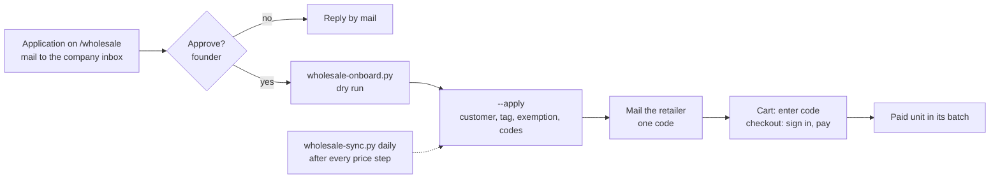

# Wholesale runbook

How a retailer goes from application to a paid order. Staff only; the page copy is `content/copy/wholesale.json`. Shopify writes (customer, tax exemption, codes) and every mail are the founder's go.



## The rule

A retailer pays 75% of retail (25% off, founder 2026-10-29), where retail is the variant's Shopify compare-at price, whatever preorder step the live price is on. The rate is `WHOLESALE_PERCENT` in `scripts/wholesale_lib.py` (or `--percent` for one retailer, which then names the code `WS<rate>-...`).

Shopify discount codes take a percentage off the live price, so one code cannot do this. Each retailer gets up to four customer-limited codes, one per price group:

| Slot | Code | Covers | Percentage |
|---|---|---|---|
| 1 | `WS25-FPV24` (typed by the retailer) | the largest price group | `1 - 0.75 x retail / price` |
| 2 to 4 | `WS25-FPV24-G2` to `-G4` | the other groups | same formula |

Today: variants at the 10% step get 16.6667% off, variants at the 20% step 6.25% off, variants at retail 25%. A variant already under 75% of retail gets no code. Groups change whenever a price step moves, so `wholesale-sync.py` re-points the slots (unused slots are deactivated). The cart sends all four codes when the buyer enters the main code (`app/lib/wholesale-codes.ts`), so the retailer types one.

## Onboard one retailer

1. Approve the application (founder). Check the shop, contact and country.
2. Dry run, nothing is written:

```bash
python3 scripts/wholesale-onboard.py --email buyer@example.eu --country ES --vat ESY1234567X --company "Example SL"
```

It checks the VAT number in VIES, finds or plans the Shopify customer by email, and prints the planned writes per slot.
3. After the founder's go, the same command with `--apply`. It tags the customer `wholesale`, sets the EU reverse charge exemption when allowed, creates the codes, then reads everything back and exits non-zero on a mismatch. Existing codes are kept, so a rerun is safe. `--code WS25-FPV24` recreates a code that was already mailed; `--slug` names the code.
4. Mail the retailer (text below).

Needs `SHOPIFY_STORE_DOMAIN`, `SHOPIFY_ADMIN_API_TOKEN` (`read/write_customers`, `read/write_discounts`) in `.env`. Never print the token.

## Automation

The workspace job `wholesale-intake` (operations repo, `tools/jobs/wholesale.py`) turns a form application into a founder card (Approve / Decline, VIES pre-checked, code proposed); an Approve runs `wholesale-onboard.py --apply` and saves the reply as a Gmail draft (EN or NL). Nothing is sent. The job `wholesale-sync` runs hourly: `wholesale-sync.py --apply` re-points the groups after a price step (no hook fires on a step, so the hourly pass bounds the gap), then `wholesale-sync.py --health` reports to the it-admin desk: a tagged customer without codes, codes without the tag, orphan group codes, price drift, and `wholesale-check.py` failures.

By hand: `python3 scripts/wholesale-sync.py` (dry run, `--apply`, `--health`) and `python3 scripts/wholesale-check.py WS25-NAME`, which builds a throwaway Storefront cart with every live variant plus the code and its companions and asserts each line costs 75% of retail to the cent. Customer eligibility is enforced only at checkout, so the check proves the prices, not the customer limit.

Percentages are stored with 4 decimals (0.1667). Every unit still lands on 75% of retail to the cent; a line of N units is up to about N x 0.18 cent cheaper (9 cents on 50 units) because 0.9 x (1 - 0.1667) is 0.74997.

## Login and checkout

The opendrone.be session is not passed to checkout: the cart is created without buyer identity and the sign-in keeps no Shopify token (`app/lib/accounts/shopify-idp.ts`, data minimisation, kept on purpose). So:

1. The retailer adds to cart and enters the code in the cart's "Wholesale code" field.
2. At Shopify checkout the retailer signs in with the approved email (Shopify mails a code). The customer-limited codes and the tax exemption apply to a signed-in customer.
3. Pay at checkout.

## VAT per case

| Retailer | Tax exemption | What the buyer pays |
|---|---|---|
| Belgium | none | 21% Belgian VAT |
| Other EU, VIES valid | `EU_REVERSE_CHARGE_EXEMPTION_RULE`, tag `reverse-charge` | no Belgian VAT, the buyer accounts for VAT locally |
| Other EU, VIES invalid, unreachable or no number | none | VAT as for a consumer, until the number is fixed and the script is rerun |
| Outside the EU (CH, AU, US, PH, ...) | none, no VIES check | checked per destination, see below |

The script sets the exemption only when VIES answers `isValid: true` and the country is not BE, so a typed VAT number alone gives nothing. The VIES answer is noted on the customer.

What the shop charges (read from the paid orders of the Shopify store, 29 Oct 2026): EU consumers pay the VAT of their own country (OSS), for example DE 19%, NL 21%, IT 22%, HU would be 27%; Belgium 21%. So an EU shop without an accepted VAT number pays its destination VAT, not Belgian VAT. Non-EU orders (US, CH, NO, GB, CA, ...) carry no tax line and pay the same VAT-inclusive list price, so for a non-EU retailer the 25% comes off a price that still contains the Belgian VAT; the shop does not strip it. Import duties and local taxes are the buyer's. Whether Shopify strips VAT from a tax-inclusive price for a reverse-charge customer is still unverified: the test order checks it.

## Shipping rate names

The international zones name every weight-band rate "Preorder: ships by 31 Mar 2027, delivery by 30 Apr 2027", which is wrong for a batch-1 order. No code reads rate names (`app/lib/international-shipping.ts` reads price and weight; `release-batch.mjs`, the promise-mismatch logic and the company app use only prices and line properties), so renaming them to "Standard shipping (bpost)" is safe before, after or together with the batch-1 regions change; the date promise stays on the line properties and the order. `python3 scripts/shipping-rename.py` lists the 378 renames (dry run), `--apply` renames zone by zone and reads every rate back (name changed, price and weight conditions identical). Run it once, on the founder's go.

## Test order (before the first announcement)

One real order from a test retailer account (a founder-controlled email, tagged `wholesale`, with the exemption and a code), then refunded:

1. Put one FC and one motor (different price groups) in the cart, enter the code, sign in at checkout.
2. Check: both lines at 75% of retail, VAT removed for an EU number, a second email cannot use the code, a guest checkout gets no exemption.
3. Refund and cancel in Shopify; check the unit leaves the batch count.

## What counts against batch caps

Every paid wholesale unit is a paid customer unit: it fills its batch and moves the price step like any other order (`app/lib/shopify-orders.ts`: paid, not cancelled, not test, `currentQuantity`). Allocation follows the shipping country (`content/preorders.json` `regions`, README "Run a preorder campaign").

## Refund or cancellation

Refund or cancel in Shopify as usual: the unit leaves the batch count and the price step automatically. The codes and the exemption stay on the customer. A retailer who leaves: deactivate the codes in Shopify admin and remove the `wholesale` tag.

## Mail text for a retailer

English:

```
Your application is approved. How it works: order in our shop at opendrone.be. Put your products in the cart, enter your personal code WS25-NAME in the Wholesale code field, and sign in with this email address at checkout (Shopify sends you a code). You pay 25% off retail. Belgian shops pay 21% VAT. Shops in another EU country with a valid VAT number pay no Belgian VAT (reverse charge); we check the number in VIES. Outside the EU we confirm VAT and shipping per country. You pay at checkout and shipping is charged as normal. Every order ships with its batch. Current prices and dates are on each product page.
```

Nederlands:

```
Je aanvraag is goedgekeurd. Zo werkt het: bestel in onze shop op opendrone.be. Leg je producten in de winkelwagen, vul je persoonlijke code WS25-NAAM in bij Wholesale code en meld je bij het afrekenen aan met dit e-mailadres (Shopify stuurt je een code). Je betaalt 25% korting op de adviesprijs. Belgische winkels betalen 21% btw. Winkels in een ander EU-land met een geldig btw-nummer betalen geen Belgische btw (verlegging); wij controleren het nummer in VIES. Buiten de EU bevestigen we btw en verzending per land. Je betaalt bij het afrekenen en verzending wordt normaal aangerekend. Elke bestelling wordt verzonden met haar batch. Actuele prijzen en data staan op elke productpagina.
```
