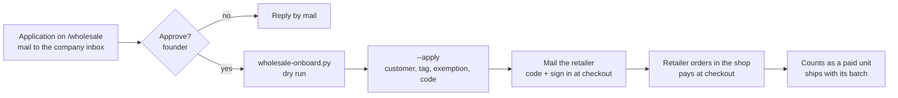

# Wholesale runbook

How a retailer goes from application to a paid order. Staff only; the page copy is `content/copy/wholesale.json`. Shopify writes (customer, tax exemption, code) are the founder's go.



## Rate

One number: `WHOLESALE_PERCENT` in `scripts/wholesale-onboard.py` (25, founder 2026-10-29), or `--percent` for one retailer. Commerce seed 79 still says 20; a retailer promised another rate needs a founder decision, not an edit here.

## Onboard one retailer

1. Approve the application (founder). Check the shop, contact and country.
2. Dry run, nothing is written:

```bash
python3 scripts/wholesale-onboard.py --email buyer@example.eu --country ES --vat ESY1234567X --company "Example SL"
```

It checks the VAT number in VIES, finds or plans the Shopify customer by email, and prints the planned writes and a stacking table.
3. After the founder's go: the same command with `--apply`. It tags the customer `wholesale`, sets the EU reverse charge exemption when allowed, creates the code, then reads everything back and exits non-zero on a mismatch. A code that already exists is kept, so a rerun is safe. `--code WS25-FPV24` recreates a code that was already mailed; `--slug` names the code.
4. Mail the retailer (text below). Sending is a founder step.

Needs `SHOPIFY_STORE_DOMAIN`, `SHOPIFY_ADMIN_API_TOKEN` (`read/write_customers`, `read/write_discounts`) in `.env`. Never print the token.

## What the code is

| Property | Value |
|---|---|
| Name | `WS<rate>-<NAME>`, uppercase, for example `WS25-FPV24` |
| Type | Shopify percentage code on all products, for one customer only (customer eligibility), unlimited uses |
| Combines | with shipping discounts only |
| Takes the percentage off | the live price, which is retail only when no preorder step runs |

Shopify cannot express "25% off retail" when the live price is already under retail. During a preorder step the code stacks: 10% step plus 25% is 32.5% off retail, 20% step plus 25% is 40%. The script prints this table and refuses `--apply` unless `--accept-stacking` is given. Before the first apply the founder picks: accept the stacking, start the code (`startsAt`) after the steps end, or keep draft orders at the agreed price until then.

## VAT per case

| Retailer | Tax exemption | What the buyer pays |
|---|---|---|
| Belgium | none | 21% Belgian VAT |
| Other EU, VIES valid | `EU_REVERSE_CHARGE_EXEMPTION_RULE`, tags `reverse-charge` | no Belgian VAT, the buyer accounts for VAT locally |
| Other EU, VIES invalid or unreachable | none | VAT as for a consumer, until the number is fixed and the script is rerun |
| Outside the EU (CH, AU, US, PH, ...) | none, no VIES check | checked per destination, see below |

The script sets the exemption only when VIES answers `isValid: true` and the country is not BE, so a typed VAT number alone gives nothing. The VIES answer is noted on the customer.

Outside the EU the price in Shopify includes Belgian VAT; whether checkout strips it for a destination is not verified. Place one test order per destination type before promising a net price. Import duties and local taxes are the buyer's; the storefront does not include them for destinations other than the EU and the US.

Not verified on this store (needs one test order with a test customer): that the exemption removes VAT from a tax-inclusive price, and that a customer-limited code is accepted. Shopify applies exemptions to a signed-in customer.

## How the retailer orders

1. Browse opendrone.be, add to cart as usual.
2. At Shopify checkout, sign in with the approved email (the store's customer account sends a code to that address), then enter the personal code. The opendrone.be session is not passed to checkout: the cart is created without buyer identity and the sign-in keeps no Shopify token (`app/lib/accounts/shopify-idp.ts`).
3. Pay at checkout. No invoice, no draft order.

Passing the signed-in buyer to the cart (`buyerIdentity.customerAccessToken`) would need the access token kept and refreshed and the `customer-account-api:full` scope, which reverses the data minimisation decision in that file. Not done; a founder decision.

## What counts against batch caps

Every paid wholesale unit is a paid customer unit: it fills its batch and moves the price step like any other order (`app/lib/shopify-orders.ts`: paid, not cancelled, not test, `currentQuantity`). Allocation follows the shipping country:

| Destination | Batch 1 FC and ESC (paid stock in Belgium) | Other products |
|---|---|---|
| EU | yes, while sellable units remain (cap `units` less `reserved`) | per `content/preorders.json` |
| US | no, EU only; the order goes to the March batch | March batch, ships by the US date |
| Other (CH, AU, PH, ...) | no, EU only; international preorder in the March batch | March batch, international delivery date, shipping confirmed at checkout |

So a non-EU retailer buys FC and ESC for the March batch only. If the founder opens batch 1 beyond the EU, only `regions` of that batch in `content/preorders.json` changes: A (all regions) removes the `regions` entry, B (all except US) needs a region the allocator does not have yet (code change), C (wholesale only) needs a code change too. Until then the copy says EU only for batch 1.

## Refund or cancellation

Refund or cancel in Shopify as usual: the unit leaves the batch count and the price step automatically (`currentQuantity`). The code and the exemption stay on the customer. A refund of an exempt order needs no VAT correction. A retailer who leaves: delete the code in Shopify admin and remove the `wholesale` tag.

## Mail text for a retailer

English:

```
Your application is approved. How it works: order in our shop at opendrone.be. At checkout, sign in with this email address (Shopify sends you a code) and enter your personal code WS25-NAME, which takes 25% off retail. Belgian shops pay 21% VAT. Shops in another EU country with a valid VAT number pay no Belgian VAT (reverse charge); we check the number in VIES. Outside the EU we confirm VAT and shipping per country. You pay at checkout. Every order ships with its batch: batch 1 of the flight controller and ESC ships in the EU only, orders from other countries go into the March 2027 batch. Current prices and dates are on each product page.
```

Nederlands:

```
Je aanvraag is goedgekeurd. Zo werkt het: bestel in onze shop op opendrone.be. Meld je bij het afrekenen aan met dit e-mailadres (Shopify stuurt je een code) en vul je persoonlijke code WS25-NAAM in, goed voor 25% korting op de adviesprijs. Belgische winkels betalen 21% btw. Winkels in een ander EU-land met een geldig btw-nummer betalen geen Belgische btw (verlegging); wij controleren het nummer in VIES. Buiten de EU bevestigen we btw en verzending per land. Je betaalt bij het afrekenen. Elke bestelling wordt verzonden met haar batch: batch 1 van de flight controller en ESC wordt alleen in de EU verzonden, bestellingen uit andere landen gaan in de batch van maart 2027. Actuele prijzen en data staan op elke productpagina.
```
