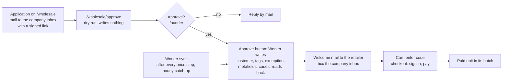

# Wholesale runbook

How a retailer goes from application to a paid order. Staff only; the page copy is `content/copy/wholesale.json`. Shopify writes (customer, tax exemption, codes) and every mail are the founder's go.



## The rule

A retailer pays 75% of retail (25% off, founder 2026-10-29), where retail is the variant's Shopify compare-at price while a preorder step is below it, else its price (at the retail step `app/lib/shopify-price-tier.ts` clears the compare-at), whatever preorder step the live price is on. The rate is `WHOLESALE_PERCENT` in `scripts/wholesale_lib.py` (or `--percent` for one retailer, which then names the code `WS<rate>-...`).

Reverse-charge retailers (EU, outside Belgium, VIES-valid) pay 75% of NET retail: retail divided by 1 plus the standard VAT rate of their country (`EU_VAT` in `wholesale_lib.py`, with its source and date), for example 39.00 x 0.75 / 1.21 = 24.17 for a Spanish retailer on FC Lite 30x30. Reason: Shopify keeps a tax-inclusive price unchanged for a tax-exempt customer (no VAT line, same gross price; [Shopify help, Tax overrides and exemptions](https://help.shopify.com/en/manual/taxes/tax-overrides): the customer "will still be charged the full listed product price"), so without the division they would pay 0.75 x gross and then add their own VAT on top. The groups are therefore per customer, and `wholesale-sync.py` and `wholesale-check.py` expect the net price for an exempt customer. Every retailer pays 75% of its own market's retail (founder 2026-11-15): Belgian retailers 75% of the VAT-inclusive list price; International retailers (every non-EU country except the US, the UK included for now) 75% of the International price, the list price without EU VAT (list / 1.21 with a .00/.50/.90 ending, fixed prices on a price list whose `-17.3554%` adjustment is the fallback; `base_price_problem` in `wholesale_lib.py` reports it missing and `wholesale-onboard.py --apply` then refuses a non-EU retailer); US retailers 75% of the US price (list +25% in USD, duties included, unchanged). The codes are computed on the market prices of the retailer's country (`country-xx` tag, set on every retailer by `wholesale-onboard.py`; a retailer without it is computed on the shop's EUR prices). The premise is a constant tax-inclusive price in every market (`INCLUDES_TAXES_IN_PRICE`; today true for Belgium, International and United States). With "dynamic" tax-inclusive pricing ([Shopify help, tax-inclusive pricing](https://help.shopify.com/en/manual/international/tax-inclusive)) Shopify may strip VAT itself and the net price would be discounted twice, so `wholesale-onboard.py --apply` refuses and the health check reports `tax-pricing` when any market is not constant.

Shopify discount codes take a percentage off the live price, so one code cannot do this. Each retailer gets up to four customer-limited codes, one per price group:

| Slot | Code | Covers | Percentage |
|---|---|---|---|
| 1 | `WS25-FPV24` (typed by the retailer) | the largest price group | `1 - 0.75 x retail / price` |
| 2 to 4 | `WS25-FPV24-G2` to `-G4` | the other groups | same formula |

Today: variants at the 10% step get 16.6667% off, variants at the 20% step 6.25% off, variants at retail 25%. A variant already under 75% of retail gets no code. Both lanes of a board count: the Buy now and the Pre-order variant share one SKU but are separate variants with their own price, so groups, the sync and the cart check work per variant id. Groups change whenever a price step moves, so `wholesale-sync.py` re-points the slots (unused slots are deactivated; deactivating sets an end date, and a slot that is reused later gets that end date cleared). The cart sends all four codes when the buyer enters the main code (`app/lib/wholesale-codes.ts`), so the retailer types one.

## Onboard one retailer

1. The application mail (`applicationMail` in `app/lib/trade.ts`) names each SKU and its quantity and carries a "Review and approve" link: the application (email, country, VAT number, company, contact, mail language) signed with HMAC-SHA256 under `WHOLESALE_APPROVE_SECRET`, valid 30 days (`app/lib/wholesale-approve-token.ts`). Check the shop, contact and country.
2. Open the link. `/wholesale/approve` runs the dry run of `wholesale-onboard.py` and writes nothing (mail scanners open links): VIES answer, exemption and why, customer found or to create, tags, note, metafields, price base, each code slot with its percentage and worst rounding, and the welcome mail it will send. An unsigned or altered link answers 403, an expired one 410.
3. After the founder's go, press Approve. The Worker (`app/lib/wholesale-approve.ts`) re-plans and refuses without writing when VIES is unreachable, when the customer has the reverse charge exemption and this run does not confirm it, when a code of the same name belongs to another customer, when the prices do not fit four codes, or on the tax-pricing and International base-price checks of The rule. Otherwise it writes what the script writes (customer by email, tags `wholesale`, `country-xx` and `reverse-charge` when exempt, the exemption, the VIES note line, the codes), plus the customer metafields `wholesale.vat_number` and `wholesale.company` (single line text, for the invoicing app), then reads everything back. Existing codes are kept, so approving twice is safe.
4. With a clean read back it mails the retailer through Resend, reply-to and bcc the company inbox: Dutch for BE and NL, English otherwise (`welcomeMail` in `app/lib/wholesale-approve.ts`, one text per VAT case below). The page shows "Approved" with what was read back. Without Resend, or on a mismatch, the page shows the text to send by hand.

Approve writes only while `WHOLESALE_APPROVE_WRITE_ENABLED` is `"1"` (`wrangler.production.toml`), never on staging; otherwise the button only shows the plan. It needs the Worker secret `WHOLESALE_APPROVE_SECRET` (32 random bytes), `TRADE_MAIL_ENABLED` and `RESEND_API_KEY` for the mail, and an Admin token with `read_customers`, `write_customers`, `read_discounts`, `write_discounts` and `read_markets`.

### By hand (fallback)

The application mail also carries the command for this applicant. Dry run, nothing is written:

```bash
python3 scripts/wholesale-onboard.py --email buyer@example.eu --country ES --vat ESY1234567X --company "Example SL"
```

After the founder's go, the same command with `--apply`: same checks, same writes and read back as Approve. `--code WS25-FPV24` recreates a code that was already mailed; `--slug` names the code (also the way out when Approve refuses a name that belongs to another customer). Then mail the retailer the welcome text (the review page shows it). Needs `SHOPIFY_STORE_DOMAIN`, `SHOPIFY_ADMIN_API_TOKEN` (`read/write_customers`, `read/write_discounts`, `read_markets`) in `.env`. Never print the token.

## Automation

| What | Where | Writes |
|---|---|---|
| Re-point every retailer's codes right after a price step | Worker, `app/lib/preorder-ops.ts` (orders/paid webhook and the five-minute reconcile) calls `app/lib/wholesale-sync.ts` | only while `WHOLESALE_SYNC_WRITE_ENABLED` is `"1"` (`wrangler.production.toml`), never on staging |
| Catch-up for any other price change (a script, the Shopify admin) | Worker, first scheduled run of each hour (`server.ts`) | same switch |
| Outcome | `lastRuns.wholesaleSync` in `/api/status/campaign` (with the status token): counts only, no codes or customers | none |
| Application to retailer | Worker, `/wholesale/approve` from the signed link in the application mail (Onboard one retailer); the welcome mail goes out after a clean read back | only on Approve and while `WHOLESALE_APPROVE_WRITE_ENABLED` is `"1"`, never on staging |

`app/lib/wholesale-sync.ts` is a port of `scripts/wholesale_lib.py` and `scripts/wholesale-sync.py`; `app/lib/wholesale-sync.test.ts` holds the same fixtures and expected percentages as `scripts/test_wholesale_lib.py`, so a change to the maths changes both. With the switch off the Worker only logs the slots that differ (`[wholesale] dry run`). The Worker's Admin token needs `read_customers`, `read_discounts` and `write_discounts`.

By hand, and as the fallback: `python3 scripts/wholesale-sync.py` (dry run, `--apply`, `--health`) and `python3 scripts/wholesale-check.py WS25-NAME`, which builds a throwaway Storefront cart with every live variant plus the code and its companions and asserts each line costs 75% of retail to the cent. Customer eligibility is enforced only at checkout, so the check proves the prices, not the customer limit. `--health` also reports a tagged customer without codes, codes without the tag, orphan group codes and price drift.

Percentages are stored with 4 decimals (0.1667). Every unit still lands on 75% of retail to the cent; a line of N units is up to about N x 0.18 cent cheaper (9 cents on 50 units) because 0.9 x (1 - 0.1667) is 0.74997.

## Login and checkout

The opendrone.be session is not passed to checkout: the cart is created without buyer identity and the sign-in keeps no Shopify token (`app/lib/accounts/shopify-idp.ts`, data minimisation, kept on purpose). So:

1. The retailer adds to cart and enters the code in the cart's "Wholesale code" field (with `BATCH_CHOICE` on the field shows on /cart?wholesale=1, from the "Have a wholesale code?" link at the foot of /wholesale, or once a code is applied; otherwise the cart shows the link "Retailer? Enter your wholesale code", which opens it). The cart takes in-stock boards too, so the code covers both lanes. Outside the EU (not the US) the in-stock boards are a retailer exception: once the code is applied, the cart moves a board to Buy now when nothing in it waits for March, and it ships from Belgium at the International market's rates. Buy now skips the cart; the code applied in the session cart goes onto that checkout as well (`wholesaleExpressCodes`, EU and outside the EU, not the US).
2. At Shopify checkout the retailer signs in with the approved email (Shopify mails a code). Shopify's help says exempt customers "need to check out using the same email address as the one listed on their customer account"; the customer-limited codes apply to a signed-in customer.
3. Pay at checkout.

Checkout re-checks the customer limit against the signed-in address. Shop Pay can sign the buyer in automatically with another Shop account (a personal address): checkout then drops the code without a message and charges full price (seen 30 Oct 2026: an anonymous cart at EUR 21.75 with a code became EUR 26.10 under a Shop Pay login of another address). A retailer who sees full price at checkout signs out of Shop Pay there and signs in with the approved address. The cart shows "Code WS25-NAME applied." once the code is in.

## VAT per case

| Retailer | Tax exemption | What the buyer pays |
|---|---|---|
| Belgium | none | 21% Belgian VAT |
| Other EU, VIES valid | `EU_REVERSE_CHARGE_EXEMPTION_RULE`, tags `reverse-charge` and `country-xx` | no VAT line, and codes price 75% of NET retail (see The rule); the buyer accounts for VAT locally |
| Other EU, VIES invalid, unreachable or no number | none | VAT as for a consumer, until the number is fixed and the script is rerun |
| Outside the EU (CH, AU, US, PH, ...) | none, no VIES check | checked per destination, see below |

The script sets the exemption only when VIES answers `isValid: true` and the country is not BE, so a typed VAT number alone gives nothing. The VIES answer is noted on the customer.

What the shop charges (read from the paid orders of the Shopify store, 29 Oct 2026): EU consumers pay the VAT of their own country (OSS), for example DE 19%, NL 21%, IT 22%, HU would be 27%; Belgium 21%. So an EU shop without an accepted VAT number pays its destination VAT, not Belgian VAT. Non-EU orders (CH, NO, GB, CA, ...) carry no tax line and pay the International price without EU VAT; US orders pay the USD price (list +25%, duties included). The 25% comes off that market price. Import duties and local taxes are the buyer's. For a reverse-charge customer Shopify keeps the tax-inclusive price and drops the VAT line (draftOrderCalculate for a DE customer with the exemption: EUR 39.00, no tax line), which is why the codes price the net retail.

## Invoice

Every paid order of a customer tagged `wholesale` gets one sales invoice in Kyte, in the company's name, dated on the payment date and marked paid. Consumer orders get none (B2C in Belgium and OSS distance sales need no invoice). Kyte has no API, so the invoice is typed by hand from what the script prints:

```bash
python3 scripts/wholesale-invoice.py                      # paid retailer orders without the tag `invoiced`
python3 scripts/wholesale-invoice.py 1507                 # company, VAT number, net lines, VAT, text to add
python3 scripts/wholesale-invoice.py 1507 --done 20260005 --apply   # tag `invoiced`, note the Kyte number
```

| Retailer | VAT on the invoice | Sent | Extra |
|---|---|---|---|
| Belgium | 21% | Peppol (Kyte) | |
| Other EU, VIES valid | 0%, the reverse charge text the script prints, both VAT numbers | e-mail (PDF) | intra-community listing (accountant, from Kyte) |
| Other EU, no valid VAT number | the destination VAT the order carried (OSS) | e-mail (PDF) | |
| Outside the EU | 0%, export text | e-mail (PDF) | the customs papers describe each product by its function |

The lines come from the order after discounts and order edits, so the invoice total equals what the retailer paid; the script warns when they differ. A refund on an invoiced order becomes a credit note in Kyte. The company name and VAT number come from the customer (metafields `wholesale.company` and `wholesale.vat_number`, else the checkout company and the VIES line in the customer note); the script says MISSING when it has none.

## Shipping rate names

The international zones name every weight-band rate "Preorder: ships by 31 Mar 2027, delivery by 30 Apr 2027", which is wrong for a batch-1 order. No code reads rate names (`app/lib/international-shipping.ts` reads price and weight; `release-batch.mjs`, the promise-mismatch logic and the company app use only prices and line properties), so renaming them to "Standard shipping (bpost)" is safe before, after or together with the batch-1 regions change; the date promise stays on the line properties and the order. `python3 scripts/shipping-rename.py` lists the 378 renames (dry run), `--apply` renames zone by zone and reads every rate back (name changed, price and weight conditions identical). Run it once, on the founder's go.

## Test order (before the first announcement)

One real order from a test retailer account (a founder-controlled email, tagged `wholesale`, with the exemption and a code), then refunded:

1. Put one FC and one motor (different price groups) in the cart, enter the code, sign in at checkout.
2. Check: both lines at 75% of retail, VAT removed for an EU number, a second email cannot use the code, a guest checkout gets no exemption.
3. Refund and cancel in Shopify; check the unit leaves the batch count.

## What counts against batch caps

Every paid wholesale unit is a paid customer unit: it fills its batch and moves the price step like any other order (`app/lib/shopify-orders.ts`: paid, not cancelled, not test, `currentQuantity`). Allocation follows the shipping country (`content/preorders.json` `regions`, README "Run a preorder campaign").

## Refund or cancellation

Refund or cancel in Shopify as usual: the unit leaves the batch count and the price step automatically. The codes and the exemption stay on the customer. A retailer who leaves: deactivate the codes in Shopify admin and remove the `wholesale` tag.

## Mail text for a retailer

The welcome mail is `welcomeMail` in `app/lib/wholesale-approve.ts`, plain text, Dutch for BE and NL and English otherwise: 25% off retail on all OpenDrone products with no minimum; the code; how to order (cart, opendrone.be/cart?wholesale=1 or "Have a wholesale code?", sign in at checkout with the approved email, sign out of Shop Pay when it signs in another address); the VAT of the retailer's case (VAT per case); the company name at checkout; an invoice in the company's name by email after every order (Belgian companies through Peppol); prices and batch dates on each product page. `app/lib/wholesale-approve.test.ts` checks each case and language. The review page shows the exact text for one retailer.
